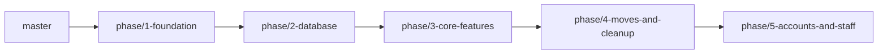

# Roadmap: the implementation plan

The phases of the rebuild, what each one delivers, its tasks and expected outputs, and where it stands. **This
is the only page that tracks status.** Each phase has its own page with its tasks, schema, APIs and diagrams
(in `docs/phases/`), and its own branch, built on the one before.

> This branch: `phase/4-moves-and-cleanup`. It contains Phases 1 to 4; the later phases are described here but not built in it.

Team: **Ali** (device side) and **Omar** (money and people side). A separate team builds the websites and the
admin / reseller apps against our APIs.

## Phases

| Phase | Branch | What it delivers | Status |
|---|---|---|---|
| [**Phase 1 · Foundation**](phases/phase-1-foundation.md) | `phase/1-foundation` | the service, brands from the host, a database per brand, settings and secrets, evidence from the old backends | ✓ done |
| [**Phase 2 · Database**](phases/phase-2-database.md) | `phase/2-database` | the six device core collections, repositories, the Redis lock, one MAC one device | ✓ done |
| [**Phase 3 · Core features**](phases/phase-3-core-features.md) | `phase/3-core-features` | devices, playlists, licenses, the V4 app routes, dev routes and playground | ✓ built, in review |
| [**Phase 4 · Moves and cleanup**](phases/phase-4-moves-and-cleanup.md) | `phase/4-moves-and-cleanup` | MAC switch, recovery, provider domain moves, cleanup of old trial devices | ✓ built, in review |
| [**Phase 5 · Accounts and staff**](phases/phase-5-accounts-and-staff.md) | `phase/5-accounts-and-staff` | customers (per brand), staff users, roles and permissions | ✓ built, in review |
| Later phases | — | old-app routes, money, payments, store, … ([below](#later-phases)) | not planned yet |

Always write a phase as its number and its name, e.g. **Phase 4 · Moves and cleanup**.



Each branch is the previous one plus its phase, and passes every check on its own: format, lint,
typecheck, knip, unit and integration tests, build (and its end-to-end scripts).

## Tasks and expected outputs

| Phase | Tasks | Who | Expected output | Checked |
|---|---|---|---|---|
| 1 · Foundation | F-1 … F-11 | Omar (Ali: request id) | a request on a brand host is served for that brand only; unknown host 421; CI green | [unit 140 · integration 16](phases/phase-1-foundation-tests.md) |
| 2 · Database | SCH-1, SCH-2, LOCK, UNQ | Ali | migrations create every collection and index; ten parallel sign-ups make one device | [unit 181 · integration 35](phases/phase-2-database-tests.md) |
| 3 · Core features | DEV-1 … DEV-6, PL-1 … PL-8, LIC-1 … LIC-3 | Omar | merge point "Devices and licenses work": register, activate from two sources, extend, revoke | [unit 455 · integration 43 · e2e 110](phases/phase-3-core-features-tests.md) |
| 4 · Moves and cleanup | DEV-7, REC-1 … REC-3, DOM-1, DOM-2, LIC-4 | Ali | merge point "Device core works", then CORE on two brands | [unit 513 · integration 51 · e2e 142](phases/phase-4-moves-and-cleanup-tests.md) |
| 5 · Accounts and staff | ACC-1, ACC-2, CUS-1 … CUS-4, PRM-1, PRM-2, STF-1 … STF-3 | Omar (Ali reviews) | merge point "Accounts work": the same email on two brands is two accounts; a staff member limited to one brand is refused on another | [unit 592 · integration 59 · e2e 222](phases/phase-5-accounts-and-staff-tests.md) |

Each phase page lists every task with its expected output and "done when"; its tests page lists every test it adds,
what each proves, how to run them, and the result on that branch.

Reference, kept current: the device core schema [SCHEMA.md](SCHEMA.md), the rules of each module
[modules/](modules/), the checks [TESTING.md](TESTING.md), open questions [DISCUSSIONS.md](DISCUSSIONS.md),
what the old backends did [FEATURES.md](FEATURES.md), background and decisions [PLAN.md](../PLAN.md).

## How the work flows

```
Phase  →  Features (one branch each)  →  Merge point (merge and test together)  →  next phase
```

- A **phase** is a group of features that ends when everything in it is on its branch, green, and its merge
  point (if it has one) passes.
- A **feature** is one branch (`feature/<name>`) merged into its phase branch.
- A **merge point**: both of us run the agreed test together before going on.
- No dates or sprints; the order comes from what each feature needs.
- Task ids (F-, SCH-, DEV-, PL-, LIC-, REC-, DOM-, and for Phase 5 ACC-, CUS-, PRM-, STF-) are the ones in
  commit messages.

## Later phases

Not planned in detail yet. Each gets a number, a name, a page and a branch when it is planned. The candidates,
in the order the earlier plan had them; Ali's and Omar's can run side by side:

- **Old-app routes, the rest:** legacy, signed TV / Android, Roku, iOS and CRPlayer routes, byte for byte, including
  `apply_recovery`, `change-code` (no old backend has it) and `status_check` on every host (Ali).
- **Resellers, wallet, codes and coupons** (Omar), with the money tables designed first.
- **Payments:** every provider behind one interface (Omar).
- **Store and transfers, partners** (Ali).
- **Content, translations, app updates** (Omar).
- **Protection and jobs:** rate limits, quarantine, scheduled cleanup (Ali).
- **Website, admin and reseller APIs** with the frontend team.
- **Data move** from the three old backends, then **launch** (load and security checks, monitoring, runbook).
- **Account plans** and the **v5 device API** last.
