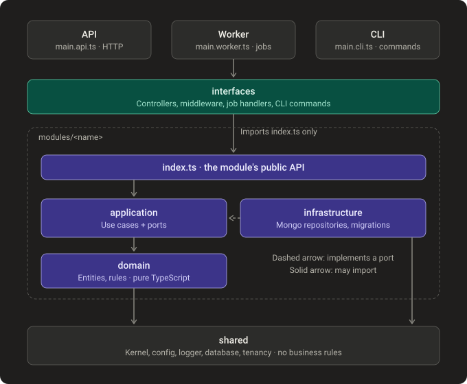

# Architecture layers

How the code is split: three processes built from one codebase, and the layers inside every feature module. Source: [ARCHITECTURE.md](../ARCHITECTURE.md) §3–4. Status: built (only the `tenants` module exists so far).

| Process | Does | Never does |
|---|---|---|
| API | Answers HTTP requests | Run scheduled jobs |
| Worker | Background and scheduled jobs (each runs once cluster-wide) | Serve HTTP |
| CLI | One-off commands: `migrate:central`, `migrate:tenants`, `tenants:seed`, `tenant:create` | Stay running |

| Layer | Example in this repo | Must not contain |
|---|---|---|
| domain | `Tenant`, `HostName` | NestJS, MongoDB, HTTP, `new Date()` |
| application | `ResolveTenantUseCase`, `TenantRepository` | Wire formats, `req`/`res` |
| infrastructure | `MongoTenantRepository`, `tenantsMigrations` | Business rules |
| interfaces | `TenantController`, `TenantMiddleware` | Business rules, direct DB calls |

Import rules are enforced by `eslint-plugin-boundaries` in CI.
