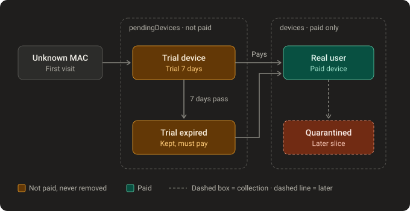
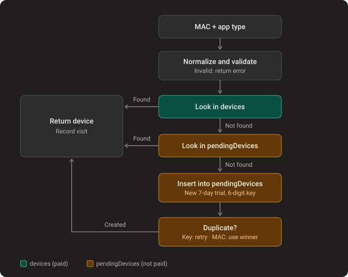
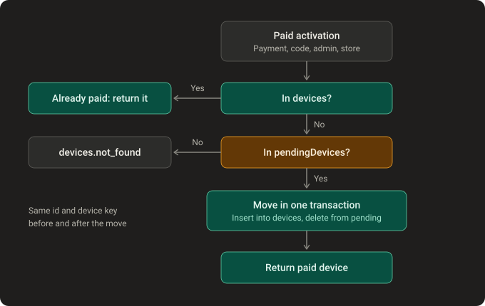

# Device registration

How a device the brand has never seen gets a trial, and how it becomes a real user. Feature: "Auto-register unknown MAC with trial" ([FEATURES.md](../FEATURES.md) §2), all apps of ibo, bob and cr.

> **Status: built** in `src/modules/devices/` (core and CLI commands; app doors such as legacy, V4 and store come later). Spec: [2026-10-19-device-registration-design.md](../superpowers/specs/2026-10-19-device-registration-design.md).
>
> Agreed rules:
> - A new device waits in `pendingDevices` and moves into `devices` **only when it pays**. `devices` holds paying users only.
> - Unpaid devices are **never removed**. Their record keeps the trial end date, so the same MAC can never get a second trial.

## 1. States

- Two collections in each brand's own database (`cr7`, `ibo`, …).
- Coming back never resets anything: the same MAC finds its own record, with the same device key and the same trial end date.
- "Pays" means any paid activation: online payment, reseller code, coupon, admin or store.

## 2. Register-or-get (`RegisterOrGetDeviceUseCase`)

Runs every time an app reaches the backend with a MAC. Paid users are checked first, so a paid device always wins.

- **Duplicate key:** two devices drew the same 6-digit key, so pick a new one (max 5 tries).
- **Duplicate MAC:** another request for the same MAC created the record a moment earlier, so return that record instead of making a second one.

## 3. Paying moves the device (`ActivateDeviceUseCase`)

Called by whatever grants a paid licence. Payments are not built yet; until then `pnpm cli device:activate <brand> <mac>` simulates it.

The insert into `devices` and the delete from `pendingDevices` happen in one MongoDB transaction, so the device is never in both collections and never lost.

## 4. What is stored where

| Field | `pendingDevices` | `devices` |
|---|---|---|
| `_id` | UUID | Same UUID (kept when moved) |
| `macAddress` | `aa:bb:cc:dd:ee:ff`, unique | Unique |
| `appType` | `samsung`, `android`, `roku`… | Same |
| `deviceKey` | 6 digits, unique | Same key, unique |
| `trialExpiresAt` | First visit + 7 days | Kept for reference |
| `license` | — | Paid plan and expiry (comes with payments) |
| `createdAt`, `lastSeenAt` | Yes | Yes, plus `activatedAt` |

Indexes (tenant migration `0001-devices-indexes`, run with `pnpm cli migrate:tenants`): unique `macAddress` and unique `deviceKey` on both collections. No TTL index: nothing is removed automatically.

## Compared with the old backends

| | Old (ibo, bob, cr) | New |
|---|---|---|
| Unknown MAC | Permanent row in `devices` immediately | Row in `pendingDevices`; `devices` stays paying users only |
| Duplicates | No unique index; the same MAC can have several rows | Unique MAC and device key; races reuse the winner |
| Trial again later | Yes, after a cleanup job deletes the row | Never: the pending record is kept with its trial end date |
| Cleanup | Cron jobs (6 months / 120 days / 400 days), often in every worker | None |
