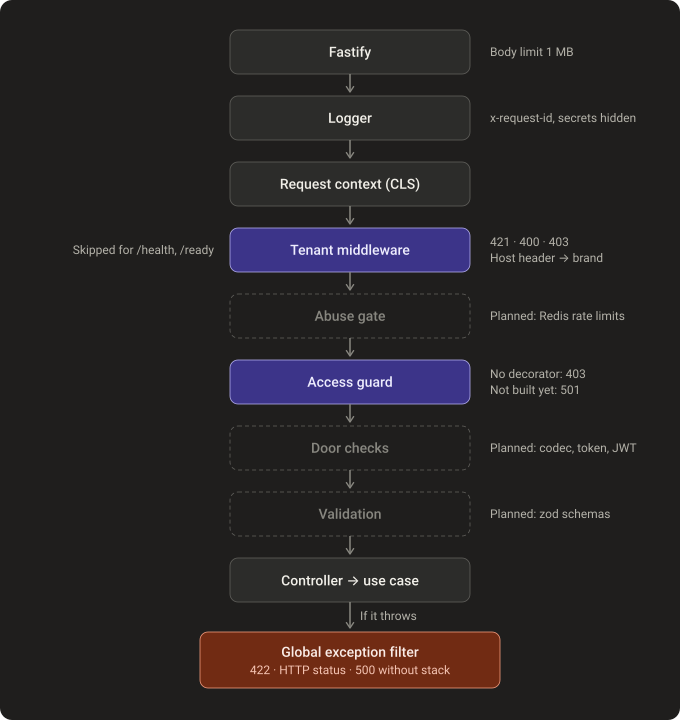

# Request pipeline

What an HTTP request passes through in the API process, in order. Source: `src/main.api.ts`, `src/api.module.ts`, [ARCHITECTURE.md](../ARCHITECTURE.md) §5. Status: solid boxes are built, dashed boxes are planned.

| Step | File | Status |
|---|---|---|
| Fastify | `src/main.api.ts` | Built |
| Logger | `src/shared/logger/logger.module.ts` | Built |
| Request context | `src/api.module.ts` (`ClsModule.forRoot`) | Built |
| Tenant middleware | `src/interfaces/http/tenant/tenant.middleware.ts` | Built |
| Abuse gate | — | Planned (ABU) |
| Access guard | `src/shared/auth/access.guard.ts` | Built for `@Public()`; other kinds answer 501 |
| Door checks, validation | — | Planned (LEG, STO, IDN) |
| Exception filter | `src/shared/errors/global-exception.filter.ts` | Built |
