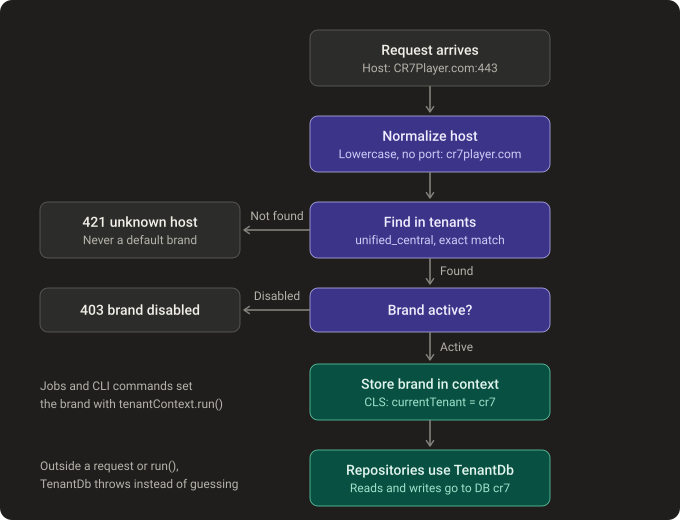

# Tenancy

How one backend serves 24 brands: which brand a request belongs to, where each brand's data lives, and how code reaches the right database. Source: `src/modules/tenants/`, `src/shared/tenancy/`, [ARCHITECTURE.md](../ARCHITECTURE.md) §6. Status: built.

## Host → brand → database

## Where data lives

| Database | Holds |
|---|---|
| `unified_central` (shared) | `tenants` (24 brands and their hosts), `_migrations`; planned: staff, resellers, wallet, codes, audit log |
| One per brand, named after the slug (`cr7`, `ibo`, `bob_pro`…) | That brand's data; planned: `pendingDevices`, `devices`, playlists, customers |

- Brand database name = slug with `-` turned into `_`. `admin`, `local` and `config` are refused.
- A brand database appears on its first write (MongoDB creates databases lazily).
- `pnpm cli migrate:tenants` applies each module's indexes to every brand database.

## How code reaches the current brand's database

| Caller | How the brand is set |
|---|---|
| HTTP request | `TenantMiddleware` from the `Host` header |
| Background job / CLI | `tenantContext.run(tenant, fn)` |
| Code outside both | `TenantContext.current` throws: it never guesses a brand |

Repositories never receive the brand as an argument. They call `tenantDb.collection('…')` on every method; `TenantDb` reads the brand from the request context and asks `TenantDbRegistry` for that brand's database (one pooled MongoDB client per cluster).
