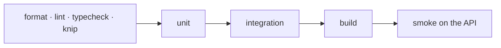

# Phase 1 · Foundation: tests

The tests this phase added, what each one proves, how to run them, and the result on this branch. The phase page
is [phase-1-foundation.md](phase-1-foundation.md).

## The checks

| Level | Command | Needs |
|---|---|---|
| Static | `pnpm format:check && pnpm lint && pnpm typecheck && pnpm knip` | nothing |
| Unit | `pnpm test` | nothing |
| Integration | `pnpm test:int` | Docker, or a MongoDB replica set and a Redis you can wipe (below) |
| Build | `pnpm build` | nothing |
| Smoke | `pnpm dev:api`, then `/health`, `/ready`, `/tenant` | MongoDB and Redis |



## Unit tests (22 files)

| File | Cases | Proves |
|---|---|---|
| `src/shared/config/env.schema.spec.ts` | 4 | bad or missing settings stop the process at startup |
| `src/shared/auth/access.guard.spec.ts` | 3 | a route without an access decorator is refused |
| `test/unit/route-access.spec.ts` | 2 | every route in the app declares who may call it |
| `src/shared/crypto/envelope-encryption.spec.ts` | 6 | a secret opens only with its key and for its own brand and name; never stored in clear; a fresh data key each time; tampering refused; a 32-byte master key required |
| `src/shared/database/mongo-client.pool.spec.ts` | 5 | one client per URI even for concurrent callers; a failed connection retried; idle clients closed and reopened; unanswered pings reported |
| `src/shared/kernel/mac-address.spec.ts` | 1 | MAC formats normalize to `aa:bb:cc:dd:ee:ff` |
| `src/shared/kernel/money.spec.ts` | 5 | money in integer minor units, never floats |
| `src/modules/tenants/domain/host-name.spec.ts` | 1 | invalid hosts are refused (a table of cases) |
| `src/modules/tenants/application/use-cases/resolve-tenant.use-case.spec.ts` | 5 | exact host match; unknown host and disabled brand refused |
| `src/modules/tenants/application/use-cases/create-tenant.use-case.spec.ts` | 5 | an active brand with normalized hosts and its own database name; an existing slug, a host another brand answers on, no hosts or an invalid host refused |
| `src/modules/tenants/application/use-cases/seed-tenants.use-case.spec.ts` | 5 | missing brands created; a second run changes nothing; hosts added and names changed but never removed; never moves another brand's host; invalid hosts reported |
| `src/modules/tenants/application/use-cases/update-tenant-settings.use-case.spec.ts` | 6 | settings merge and validate; defaults kept |
| `src/modules/tenants/application/use-cases/tenant-config.use-case.spec.ts` | 5 | `tenantConfig` defaults (trial 7 days, EUR) and validation |
| `src/modules/tenants/application/use-cases/tenant-secrets.use-case.spec.ts` | 9 | set, read, list (names only), delete; values never returned |
| `src/modules/tenants/application/tenant-memory-cache.spec.ts` | 3 | entries expire; only the brand that changed is emptied; a value loaded before a change is not kept |
| `src/modules/tenants/infrastructure/redis-cached-tenant.repository.spec.ts` | 5 | host lookups cached in Redis, cleared on change |
| `src/modules/tenants/infrastructure/tenant.document.spec.ts` | 3 | stored brand shape checked on read |
| `test/unit/tenant-db.spec.ts` | 7 | no brand is guessed outside a request; concurrent requests for different brands kept apart; a credential works only for its own brand |
| `test/unit/tenant-middleware.spec.ts` | 6 | the brand that owns the host is served; 421 for an unknown host and for a subdomain of a known one (no substring match); 403 for a disabled brand; settings in the request context; health checks skip the brand check |
| `test/unit/tenant-seed-file.spec.ts` | 4 | `seeds/tenants.seed.json` is valid and hosts are unique |
| `test/unit/cli-args.spec.ts` | 2 | a dotted setting name becomes a nested change; a setting name is required |
| `src/modules/_template/application/use-cases/rename-example.use-case.spec.ts` | 3 | the module template works as a copy-me example |

"Cases" counts the `it` blocks in the file; tables of cases (`it.each`) run more, so the totals below are higher.

## Integration tests (4 files)

| File | Cases | Proves |
|---|---|---|
| `test/integration/health.int-spec.ts` | 6 | `/health` alive; `/ready` reaches Mongo, Redis and brand databases; the request id echoed, also on a reply the brand check ends early; an unsafe request id replaced; JSON 404 without internals |
| `test/integration/migration-runner.int-spec.ts` | 1 | migrations run in id order, once |
| `test/integration/tenant-db.int-spec.ts` | 1 | each brand gets its own database |
| `test/integration/tenant-isolation.int-spec.ts` | 8 | brand A never reads or writes brand B; secrets bound to their brand |

## How to run them

```sh
pnpm test                         # unit
pnpm test:int                     # integration, with Docker
# without Docker: servers you are happy to wipe, never your dev database
TEST_MONGO_URI="mongodb://localhost:27019/?replicaSet=rs0&directConnection=true" \
TEST_REDIS_URL=redis://localhost:6380 pnpm test:int
```

Smoke on a running API (`pnpm dev:api` after `pnpm cli migrate:central && pnpm cli tenants:seed --dev`):

| Check | Expected |
|---|---|
| `GET http://localhost:3000/health` | `{"status":"ok"}` |
| `GET /ready` | `{"status":"ok","checks":{"mongo":"up","redis":"up","tenantDbs":"up"}}` |
| `GET /tenant` with `Host: ibo.localhost` | `{"slug":"ibo","name":"IBO Player"}` |
| `GET /tenant` with `Host: nope.example` | 421 |

## Result on this branch

| Date | Static | Unit | Integration | Build | Smoke |
|---|---|---|---|---|---|
| 27 Oct 2026 | format, lint, typecheck, knip green | **140/140** | **16/16** | OK | health, ready, tenant, 421 all as expected |
