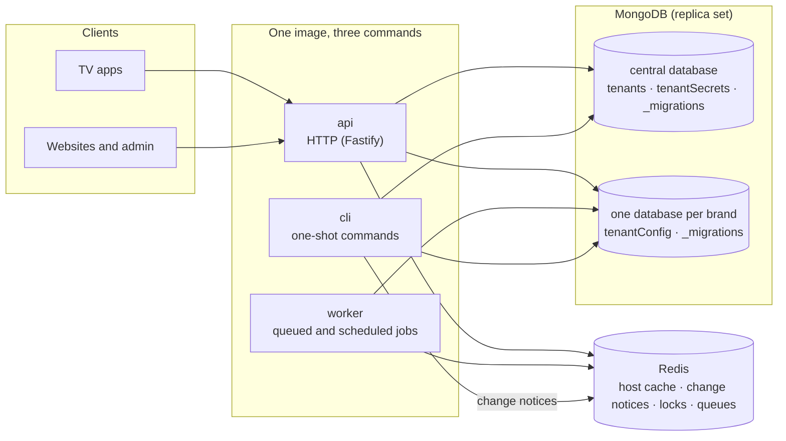
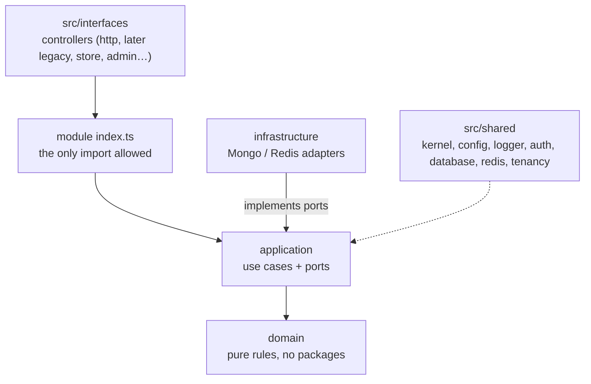
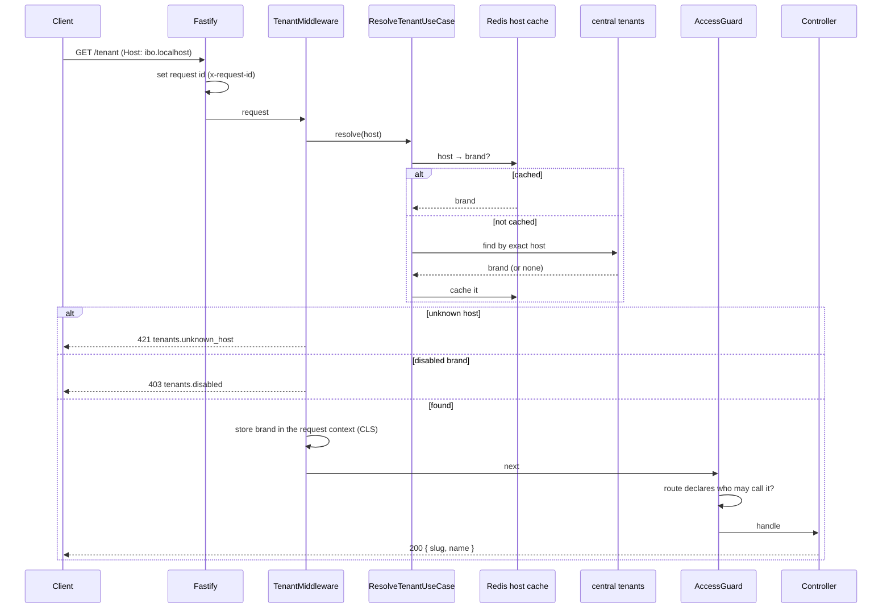
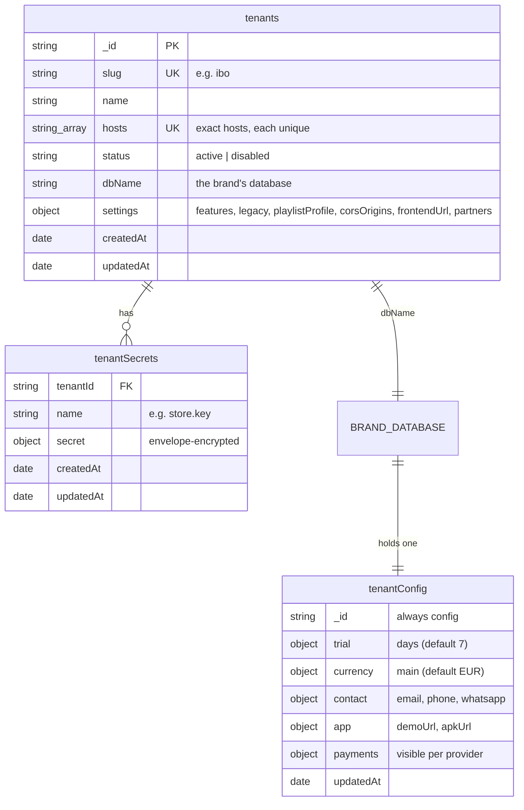

# Phase 1 · Foundation

Branch `phase/1-foundation` · built on: nothing (the first phase) · status: **done**

**Tests:** [phase-1-foundation-tests.md](phase-1-foundation-tests.md): every test this phase adds, what it proves, how to run it, and the result on this branch.

An empty, production-grade service that knows which brand each request is for, plus the evidence from the three
old backends that every later phase is checked against. No device, license or playlist exists yet.

## Contents

1. [Goal](#goal)
2. [Tasks and expected outputs](#tasks-and-expected-outputs)
3. [Architecture](#architecture)
4. [How a request finds its brand](#how-a-request-finds-its-brand)
5. [Database schema](#database-schema)
6. [HTTP routes](#http-routes)
7. [CLI commands](#cli-commands)
8. [Configuration](#configuration)
9. [How to run and check it](#how-to-run-and-check-it)
10. [Not in this phase](#not-in-this-phase)

## Goal

- One backend for every brand: each request is served for exactly one brand, found from its host.
- Each brand has its own MongoDB database; shared data lives in one central database.
- The rules of the codebase are in place before any feature: layers, module boundaries, access on every route,
  typed config, logging with request ids, CI.
- What the old backends do is written down (routes, payloads, data shapes, recorded requests), so later phases
  rebuild it without guessing.

## Tasks and expected outputs

| Id | Task | Expected output | Commits |
|---|---|---|---|
| F-1 | Plan and briefing | `PLAN.md`, `docs/FEATURES.md`, `docs/ARCHITECTURE.md`, team briefing | `fbc5e35`, `a3c8caf` |
| F-2 | Project skeleton | NestJS on Fastify; zod config that fails fast; pino logs; error filter; access guard with 7 decorators; MongoDB pool and migration runner; Redis; BullMQ worker; CI | `d99ccb0` |
| F-3 | Evidence from the old backends | endpoint catalogue per backend, client usage, store and payment contracts, unused code (`docs/inventory/`); data profiles (`docs/data-profiles/`); codec vectors and recorded requests (`test/fixtures/legacy/`); capture tools (`tools/`) | `a3c8caf`, `d282407` |
| F-4 | Brand from the host | exact host match, unknown host refused with 421, disabled brand 403; brands seeded from `seeds/tenants.seed.json` | `ccdabc1` |
| F-5 | A database per brand | `TenantDb`: each request reads and writes only its brand's database | `05191d6` |
| F-6 | Idle brand connections close | a brand's connection pool closes when unused | `720ebc5` |
| F-7 | Integration tests on existing servers | `pnpm test:int` runs against Docker, or servers given by `TEST_MONGO_URI` / `TEST_REDIS_URL` | `05191d6` |
| F-8 | Brand settings, secrets and config | settings on the brand record; encrypted `tenantSecrets` (envelope encryption, `TENANT_SECRETS_KEY`); `tenantConfig` in each brand database with defaults | `ccdabc1` |
| F-9 | Brand CLI | `pnpm cli tenant:*`, `migrate:*`, `tenants:seed` | `5b30c10` |
| F-10 | Brand isolation suite | integration tests proving brand A never sees brand B | `05191d6` |
| F-11 | Request id under Fastify | every reply echoes `x-request-id`; logs carry it | `05191d6` |

**Done when:** a request on a brand host is served for that brand only, an unknown host is refused, every brand
has its own database, and CI is green.

## Architecture



Code layout (each module copies `src/modules/_template`):



## How a request finds its brand



`/health` and `/ready` skip the brand check, so load balancers can call them on any host.

## Database schema



| Collection | Database | Indexes (migration) |
|---|---|---|
| `tenants` | central | `slug_unique`, `hosts_unique` (0001) |
| `tenantSecrets` | central | `tenant_name_unique` on tenantId + name (0002) |
| `tenantConfig` | each brand | one document, `_id: "config"`; missing fields fall back to defaults |
| `_migrations` | every database | the migrations applied there |

Brand settings and their defaults (`src/shared/kernel/tenant-settings.ts`):

| Setting | Default | Meaning |
|---|---|---|
| `features.maintenance` | false | brand in maintenance |
| `features.rawPlaylistsForAndroid44` | false | Android 4.4 builds get links as typed |
| `legacy.plainBodyAddRemove` | false | old add/remove routes take a plain body |
| `playlistProfile` | `xc` | Xtream playlists as parts (`xc`) or one link (`general`) |
| `corsOrigins` | [] | allowed origins |
| `frontendUrl` | null | the brand site |
| `partners.starArcsAppName` | null | partner app name |

Secrets are encrypted with a data key per secret, itself encrypted with `TENANT_SECRETS_KEY`; a secret only
decrypts for its own brand and name. Values are never logged or returned.

## HTTP routes

| Method | Path | Access | Answer |
|---|---|---|---|
| GET | `/health` | public, any host | `{ status: "ok" }` while the process runs |
| GET | `/ready` | public, any host | `{ status, checks: { mongo, redis, tenantDbs } }` |
| GET | `/tenant` | public, brand host | `{ slug, name }` of the brand served |

Every route must declare who may call it with one of `@Public()`, `@LegacyDevice()`, `@Store()`, `@Staff()`,
`@Reseller()`, `@Customer()`, `@Platform()`; an undeclared route is refused and fails `route-access.spec.ts`.

## CLI commands

```sh
pnpm cli migrate:central                       # central migrations
pnpm cli migrate:tenants [slug...]             # brand migrations, every brand by default
pnpm cli tenants:seed [--dev]                  # brands from seeds/tenants.seed.json (+ <slug>.localhost)
pnpm cli tenant:create <slug> "<name>" <host>...
pnpm cli tenant:show <slug>
pnpm cli tenant:add-host <slug> <host>...
pnpm cli tenant:set <slug> <path> <value>      # settings, e.g. features.maintenance true
echo '<value>' | pnpm cli tenant:set-secret <slug> <name>
pnpm cli tenant:secrets <slug>                 # names only
pnpm cli tenant:delete-secret <slug> <name>
pnpm cli tenant:config <slug>                  # tenantConfig with defaults
pnpm cli tenant:config:set <slug> <path> <value>
```

A change made from the CLI reaches running APIs at once (Redis change notices clear their caches).

## Configuration

| Variable | Meaning |
|---|---|
| `NODE_ENV` | development, test or production |
| `PORT` | HTTP port (3000) |
| `LOG_LEVEL` | pino level |
| `MONGO_URI` | a replica set |
| `MONGO_CENTRAL_DB` | the central database name |
| `REDIS_URL` | Redis |
| `TENANT_SECRETS_KEY` | the key that encrypts brand secrets (32 bytes, base64) |

## How to run and check it

```sh
pnpm install
pnpm cli migrate:central && pnpm cli tenants:seed --dev && pnpm cli migrate:tenants
pnpm dev:api                                   # http://ibo.localhost:3000/tenant
pnpm format:check && pnpm lint && pnpm typecheck && pnpm knip && pnpm test && pnpm test:int && pnpm build
```

Checked on this branch (27 Oct 2026): format, lint, typecheck, knip and build green; **unit 140/140**;
**integration 16/16** (health, migration runner, brand database, brand isolation).

## Not in this phase

Devices, licenses, playlists and every old-app route come in later phases ([ROADMAP.md](../ROADMAP.md)).
