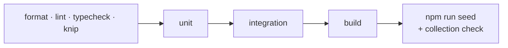

# Phase 2 · Database: tests

The tests this phase added, what each one proves, how to run them, and the result on this branch. The phase page
is [phase-2-database.md](phase-2-database.md); the Phase 1 tests ([phase-1-foundation-tests.md](phase-1-foundation-tests.md))
still run here.

## The checks

Same levels as Phase 1 (static, unit, integration, build), plus the example data:



## Unit tests added (5 files)

| File | Cases | Proves | Task |
|---|---|---|---|
| `src/modules/devices/application/device-identity.spec.ts` | 11 | a new device only when its MAC is in neither collection; ten sign-ups at once make one device; a paid MAC returns the paid device; no lock (Redis down) refuses changes but lookups work; move to paid keeps id, MAC, key; a stopped move is finished; a device caught mid-move is paid; a MAC change only to a free MAC, one winner at once | UNQ |
| `src/modules/devices/infrastructure/device.document.spec.ts` | 4 | a trial device and a paid device (with switch and recovery records) read back unchanged; the device key is 6 digits but not unique; a paid device without its license refused | SCH-1 |
| `src/modules/licensing/infrastructure/license.document.spec.ts` | 1 | yearly and lifetime licenses read back unchanged | SCH-1 |
| `src/modules/playlists/infrastructure/playlist.document.spec.ts` | 2 | the url and the Xtream password are plain text; up to 8 backup hosts | SCH-1 |
| `src/modules/domain-migrations/infrastructure/domain-migration.document.spec.ts` | 1 | a move reads back unchanged | SCH-1 |

## Integration tests added (3 files)

| File | Cases | Proves | Task |
|---|---|---|---|
| `test/integration/device-core.int-spec.ts` | 11 | migrations create the five brand collections and `domainMigrations` with their indexes (TTL on captchas) and a second run changes nothing; the validator refuses a bad hand-written row; the same playlist cannot be saved twice; each brand sees only its own data; ten parallel sign-ups make one device; with Redis down existing devices are found and new ones refused | SCH-1, SCH-2, UNQ |
| `test/integration/redis-lock.int-spec.ts` | 6 | a held lock refuses a second caller; a waiting caller gets in after; different keys run in parallel; released on error; expires after its TTL; a late release never frees the next holder; fails closed without Redis | LOCK |
| `test/integration/seed-examples.int-spec.ts` | 2 | the examples of every collection are written; a second run changes no counts; no MAC in both device collections; every paid device points at its license | seed |

## How to run them

```sh
pnpm test && pnpm test:int        # see Phase 1 for running without Docker
npm run seed                      # then check every brand has the collections and indexes:
mongosh "mongodb://localhost:27018/?replicaSet=rs0&directConnection=true" --quiet \
  --eval 'db.getSiblingDB("ibo").getCollectionNames()'
```

Expected after `npm run seed`: every brand has `trialDevices`, `devices`, `licenses`, `playlists`, `captchas`;
each brand has 5 trial devices, 4 paid devices, 4 captchas, 5 licenses, 5 playlists; the central database has 3
provider moves; a hand-written `{ _id: "x", macAddress: "bad" }` in a brand's `trialDevices` is refused.

## Result on this branch

| Date | Static | Unit | Integration | Build | API |
|---|---|---|---|---|---|
| 27 Oct 2026 | format, lint, typecheck, knip green | **181/181** | **35/35** | OK | boots; health, ready, tenant, 421 as expected |
