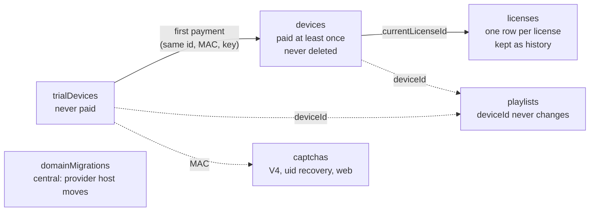
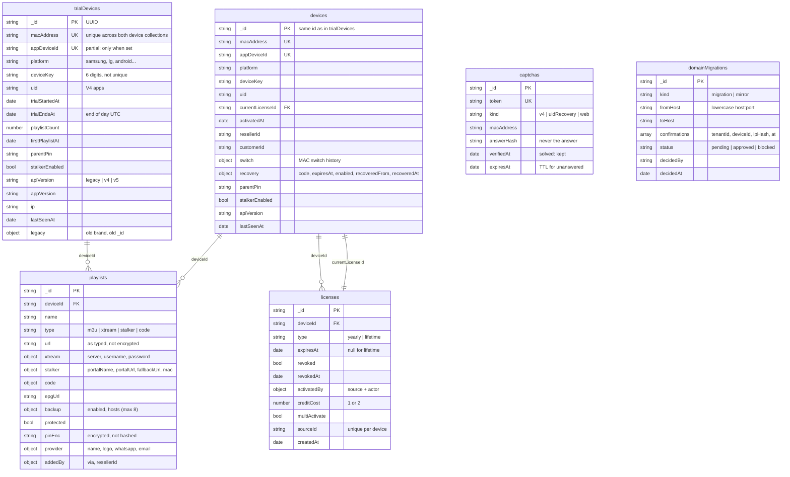
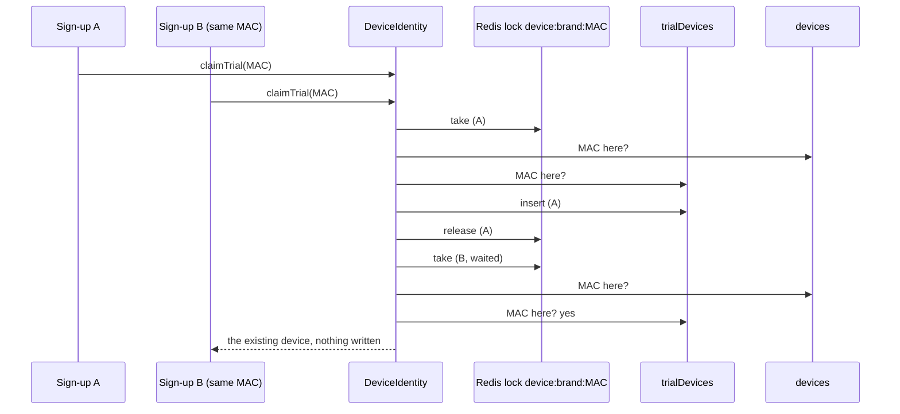
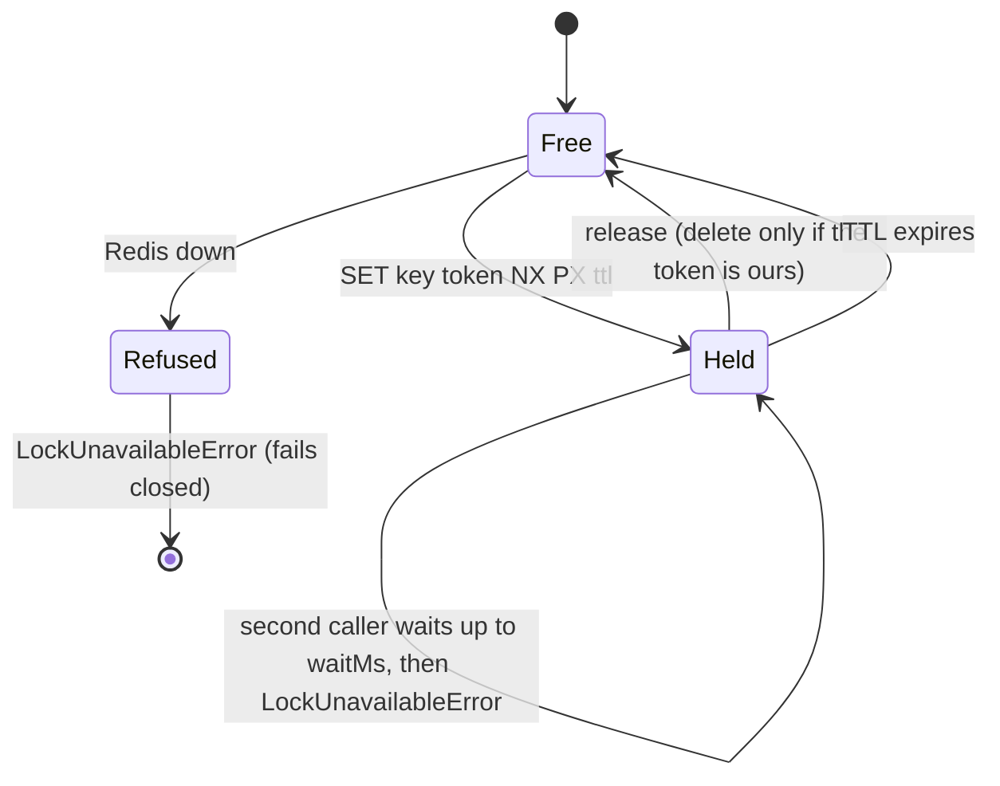

# Phase 2 · Database

Branch `phase/2-database` · built on: `phase/1-foundation` · status: **done**

**Tests:** [phase-2-database-tests.md](phase-2-database-tests.md): every test this phase adds, what it proves, how to run it, and the result on this branch.

The six collections of the device core, in code: their types, validators, indexes, migrations and repositories,
plus the two shared pieces every device change needs: the Redis lock and "one MAC, one device". No rule that a
device follows yet: features come in Phase 3.

> In this branch the device core plan is still in `docs/phase-1/` (its old name: "Phase 1, device core"). That
> folder is the plan for Phases 2 to 4; from Phase 4 on it is split into `docs/SCHEMA.md` and `docs/modules/`.

## Contents

1. [Goal](#goal)
2. [Tasks and expected outputs](#tasks-and-expected-outputs)
3. [The idea in one picture](#the-idea-in-one-picture)
4. [Database schema](#database-schema)
5. [One MAC, one device](#one-mac-one-device)
6. [The Redis lock](#the-redis-lock)
7. [Migrations](#migrations)
8. [Example data and CLI](#example-data-and-cli)
9. [How to run and check it](#how-to-run-and-check-it)
10. [Not in this phase](#not-in-this-phase)

## Goal

- The schema agreed on 21 and 25 Oct 2026 exists in every brand database (and the central one), with
  validators and indexes, created by migrations.
- Features never touch the MongoDB driver: one repository per collection, brand-isolated.
- A MAC belongs to one device across both device collections, even with many servers writing at once.

## Tasks and expected outputs

All Ali's, reviewed by Omar. Commits `d33d2c7` (code), `8332755` (docs).

| Id | Task | Expected output | Done when |
|---|---|---|---|
| SCH-1 | Create the collections | modules `devices`, `licensing`, `playlists`, `domain-migrations`; types, zod document schemas, migrations with validators and indexes | `migrate:tenants` creates the five brand collections on every brand, `migrate:central` creates `domainMigrations`; field names and types match the schema |
| SCH-2 | Data access | a repository port + Mongo adapter per collection; lookups by id, MAC, device key, app device id, uid, old id | repositories only work inside a brand; a two-brand test proves isolation; lookup by `legacy.id` works |
| LOCK | Redis lock helper | `RedisLock.withLock(key, { ttlMs, waitMs }, fn)` in `src/shared/redis/redis-lock.ts` | a held lock refuses a second caller; expires after its TTL; released on error; a late release never frees another holder; fails closed without Redis |
| UNQ | One MAC, one device | `DeviceIdentity`: `claimTrial`, `moveToPaid`, `changeMac`, `findBy*` | ten parallel sign-ups make one device; a moved device is in one collection; with Redis down existing devices are found and new ones refused |
| — | Example data | `pnpm cli seed:examples`, `npm run seed` | every brand gets example rows of every collection; a second run changes no counts |

## The idea in one picture



- A device that never paid is in `trialDevices`; it stays there after its trial ends, so it never gets a second
  trial.
- Paying moves it to `devices` with the same id, MAC and device key; its playlists keep pointing at it.
- The license state (trial, yearly, lifetime, expired, revoked) is worked out from dates, never stored.

## Database schema



| Collection | Database | Indexes |
|---|---|---|
| `trialDevices` | each brand | `mac_unique`, `app_device_id_unique` (partial), `uid` (partial), `legacy_id`, `trial_cleanup` (trialEndsAt + playlistCount) |
| `devices` | each brand | the same four, plus `current_license` |
| `licenses` | each brand | `device_history` (deviceId + createdAt), `device_source_unique` (partial) |
| `playlists` | each brand | `device`, one "same playlist once per device" index per type |
| `captchas` | each brand | `token_unique`, `mac_kind`, `expires_ttl` (TTL 0) |
| `domainMigrations` | central | `hosts_unique` (fromHost + toHost), `status`, `legacy_id` |

Conventions: `_id` is a UUID string and the old `_id` goes to `legacy.id`; camelCase fields; real dates in UTC;
indexes only from migrations. Field-by-field tables, with where each field comes from in the old data, are in
`docs/phase-1/README.md` §2 and `docs/phase-1/database-schema.html` in this branch.

## One MAC, one device

A MongoDB index covers one collection, so "a MAC is in only one of `trialDevices` and `devices`" is kept by
`DeviceIdentity` under the Redis lock for the MAC.



- **Move to paid:** under the lock, write to `devices` first, then delete from `trialDevices`. Lookups read
  `devices` first, so a device caught halfway is already paid; running the move again finishes it.
- **Reads take no lock:** with Redis down, existing TVs keep working; only new TVs, payments and MAC changes wait.

## The Redis lock



## Migrations

| Id | Database | Creates |
|---|---|---|
| `0001-trial-devices` | each brand | `trialDevices` + validator + indexes |
| `0002-devices` | each brand | `devices` |
| `0003-captchas` | each brand | `captchas` with the TTL index |
| `0004-licenses` | each brand | `licenses` |
| `0005-playlists` | each brand | `playlists` |
| `0004-domain-migrations` | central | `domainMigrations` |

## Example data and CLI

```sh
npm run seed                       # migrate:central, tenants:seed --dev, migrate:tenants, seed:examples
pnpm cli seed:examples [slug...]   # example rows in every brand (never in production)
```

Each brand gets 5 trial devices, 4 paid devices, 4 captchas, 5 licenses and 5 playlists; the central database
gets 3 provider moves (one pending, one approved, one blocked). Example ids start with `example-` and MACs with
`02:00:`, so a second run refreshes the same rows.

No new HTTP route in this phase.

## How to run and check it

```sh
npm run seed
pnpm format:check && pnpm lint && pnpm typecheck && pnpm knip && pnpm test && pnpm test:int && pnpm build
```

Checked on this branch (27 Oct 2026): format, lint, typecheck, knip and build green; **unit 181/181**;
**integration 35/35** (adds `device-core`, `redis-lock`, `seed-examples`).

## Not in this phase

Registering a device, licenses, playlists and their replies come in Phase 3 · Core features
([ROADMAP.md](../ROADMAP.md)).
