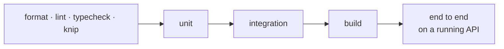

# Phase 3 · Core features: tests

The tests this phase added, what each one proves, how to run them, and the result on this branch. The phase page
is [phase-3-core-features.md](phase-3-core-features.md); the tests of Phases 1 and 2
([1](phase-1-foundation-tests.md), [2](phase-2-database-tests.md)) still run here.

## The checks



The end-to-end level is new in this phase: scripts in `tools/dev/` call a running API over HTTP (the dev-only
routes and the V4 app routes), on the real MongoDB and Redis.

## Unit tests added or grown (24 files)

| File | Cases | Proves | Tasks |
|---|---|---|---|
| `src/modules/devices/application/use-cases/register-device.use-case.spec.ts` | 23 | new MAC → trial device with key and trial end; ended trial gets no new one; visits recorded; fallback MACs and app device ids; one device for the three IBO apps; platform rule; V4 lock; review builds | DEV-1, 2, 3, 6 |
| `src/modules/devices/application/use-cases/captcha.use-cases.spec.ts` | 16 | captcha issued, expires, answered once; a solved one is kept and skips the next; uid recovery captcha | DEV-4 |
| `src/modules/devices/application/use-cases/owner-settings.use-cases.spec.ts` | 13 | device key change (old one stops), 6 digits; parent PIN on, changed, off | DEV-5 |
| `src/modules/devices/application/use-cases/change-playlist-count.use-case.spec.ts` | 4 | the first playlist is counted and its date kept (also after a delete); never below 0; a paid device is not counted | PL-2 |
| `src/modules/devices/application/device-identity.spec.ts` | 11 → 14 | the device that already has an app device id is returned; a trial whose app device id a paid device has is not moved; the MAC is locked again when the device moved before the lock | UNQ |
| `src/modules/devices/domain/device-mac.spec.ts` | 5 | a real MAC is accepted; a MAC made from an id is the same for the same id, different for different ids, and locally administered unicast | DEV-2 |
| `src/modules/devices/domain/trial.spec.ts` | 2 | trial ends at the end of day UTC | DEV-1 |
| `src/modules/devices/infrastructure/svg-captcha.image.spec.ts` | 2 | random text of the asked length without look-alike characters; a given text is drawn | DEV-4 |
| `src/modules/licensing/domain/license-rules.spec.ts` | 12 | states from dates; stacking; credit cost | LIC-1 |
| `src/modules/licensing/application/use-cases/activate-license.use-case.spec.ts` | 9 | every source; a trial device moves to devices; the same source twice activates once; parallel activations stack | LIC-2 |
| `src/modules/licensing/application/use-cases/revoke-and-history.use-cases.spec.ts` | 9 | revoke keeps the row; revoked twice refused; history oldest first with who | LIC-3 |
| `src/modules/playlists/application/use-cases/playlist.use-cases.spec.ts` | 39 | add, edit, delete, list; bulk sync; PINs; backups; one name per device | PL-2, 3, 5 |
| `src/modules/playlists/application/use-cases/playlist-reply.use-case.spec.ts` | 16 | xc, general and raw replies; demo playlist; PINs only when asked | PL-4 |
| `src/modules/playlists/application/use-cases/mac-only.use-cases.spec.ts` | 6 | add and delete by MAC; rate limit per IP; protected playlists kept | PL-6 |
| `src/modules/playlists/application/use-cases/sync-playlist-status.use-case.spec.ts` | 8 | status sync changes only `account` | PL-7 |
| `src/modules/playlists/application/use-cases/move-provider-host.use-case.spec.ts` | 9 | bulk host rewrite in one brand; plain text, not a pattern; count-only | PL-8 |
| `src/modules/playlists/domain/playlist-content.spec.ts` | 8 | Xtream links parsed once, kept as typed; other links m3u; Xtream fields make the link; Stalker MAC normalized; codes; names and EPG links checked | PL-1 |
| `src/modules/playlists/domain/backup-hosts.spec.ts` | 8 | backup hosts read like cr; links built from them | PL-5 |
| `src/modules/playlists/infrastructure/aes-pin.cipher.spec.ts` | 4 | a PIN opens only with the same key and brand; not in another brand or with another key; a clear error when the brand has no key | PL-3 |
| `src/interfaces/http/legacy/ibo-envelope.spec.ts` | 4 | decodes every request the real apps encoded and the old backends' replies (CAP-03 vectors); encodes replies the apps read, non-Latin text included | V4 routes |
| `src/interfaces/http/legacy/legacy-crypto.spec.ts` | 6 | decrypts what the old code encrypted; signs like the old backends; the TV v3 u_id; safe comparison | V4 routes |
| `src/interfaces/http/legacy/xor-device-token.spec.ts` | 3 | the old V4 device token | V4 routes |
| `src/interfaces/http/legacy/legacy-playlists.controller.spec.ts` | 3 | only status and expiry pass, whatever else the app sends; "Unknown" and "null" become no value; another device's playlist answers 403 like the old route | PL-7 |
| `src/interfaces/http/legacy/stararcs-guests.spec.ts` | 3 | `device/add` registers the MAC under the brand's app name with the partner key and relays the reply; a refusal, a reply that is not JSON, or no key give nothing | V4 routes |

## Integration tests added or grown (4 files)

| File | Cases | Proves |
|---|---|---|
| `test/integration/playlist-account-migration.int-spec.ts` | 2 | 0006 moves a code playlist's status to `account` and gives others null; 0005 → 0006 → 0007 on duplicate names: renamed, then one name per device enforced |
| `test/integration/redis-rate-limiter.int-spec.ts` | 3 | allows the limit, refuses the next with the time left, then opens again; keys kept apart; fails open without Redis |
| `test/integration/device-core.int-spec.ts` | 11 → 13 | playlists on a host found as text, never as a pattern (PL-8); playlist counters in one write each, never below 0 |
| `test/integration/redis-lock.int-spec.ts` | 6 → 7 | waits for a Redis client that is still connecting instead of refusing |

## End-to-end scripts (on a running API)

| Script | Checks | Covers |
|---|---|---|
| `pnpm e2e:devices` | 46 | register, trial end, same MAC in another format, ended trial, other brand cannot see it, fallback MACs, platform rule, V4 lock, captchas, uid recovery, TV codes, key login, key change, parental control |
| `pnpm e2e:playlists` | 24 | Xtream parsing, each type, duplicates, counters, edit, delete, PIN on the dashboard and in the app, reply profiles, demo, backups, sync, add and delete by MAC, status sync, host move |
| `pnpm e2e:licenses` | 19 | trial state, a year keeps the trial days, stacking, lifetime, same source once, parallel activations, every source recorded, revoke, pay again, history |
| `pnpm e2e:v4` | 49 | the V4 app routes in the apps' envelope: captcha, login, token, device info, forged token refused, payment shown, playlist shape, uid captcha, app type checks; manage add, update and delete with each type and refusal, another device's playlist, wrong MAC or route type, no token; `changeParentPin` by form and JSON; `device/add` against a stand-in StarArcs (run with `STARARCS_STUB_PORT`, else 47 checks) |

Scenarios the device core must cover, and what checks each:

| Id | Scenario | Checked by |
|---|---|---|
| E2E-D1 | A new MAC registers | `e2e:devices` |
| E2E-D2 | The same MAC registers 10 times at once | `device-core.int-spec.ts` |
| E2E-D3 | A fallback MAC registers from two TVs | `e2e:devices` |
| E2E-D4 | A V4 device sends the same solved code again | `e2e:devices`, `e2e:v4` |
| E2E-L1…L4 | Activate from a code, twice, stack a year, revoke | `e2e:licenses` |
| E2E-P1…P3 | Playlists CRUD and sync, PIN, reply profiles | `e2e:playlists` |

## How to run them

```sh
pnpm test && pnpm test:int                 # see Phase 1 for running without Docker
npm run seed                               # once; ends by itself (the CLI exits after each command)
pnpm dev:api                               # in another terminal
pnpm e2e:devices && pnpm e2e:playlists && pnpm e2e:licenses && pnpm e2e:v4
# PORT=3001 pnpm e2e:devices … when the API runs on another port
```

Each script prints one line per check and ends with `N passed, 0 failed`. They write new devices into the `ibo`
brand; `npm run seed` resets the example rows.

## Result on this branch

| Date | Static | Unit | Integration | Build | End to end |
|---|---|---|---|---|---|
| 27 Oct 2026 | format, lint, typecheck, knip green | **455/455** | **43/43** | OK | devices 46/46, playlists 24/24, licenses 19/19, v4 21/21 |
| 28 Oct 2026 (app routes) | format, lint, typecheck, knip green | **472/472** | **43/43** | OK | devices 46/46, playlists 24/24, licenses 19/19, v4 49/49 (with the stand-in StarArcs) |
