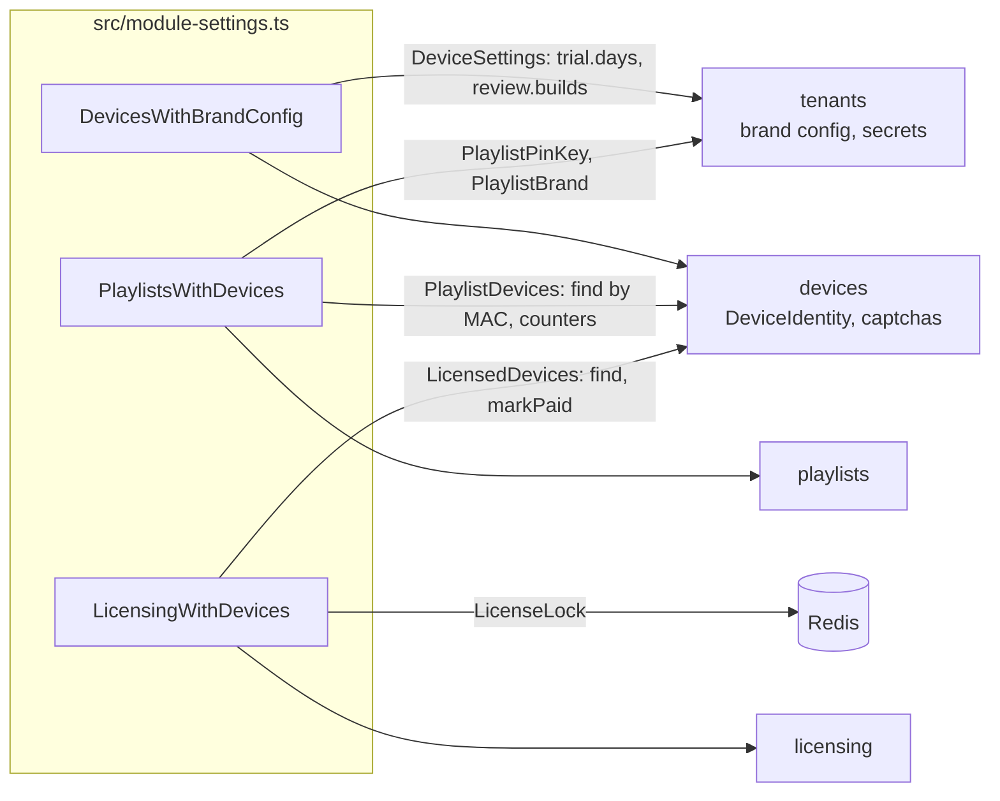
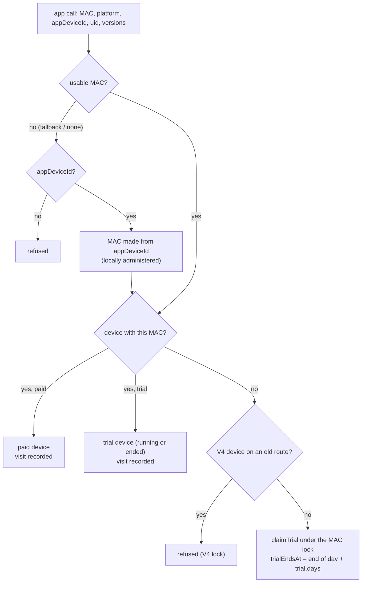
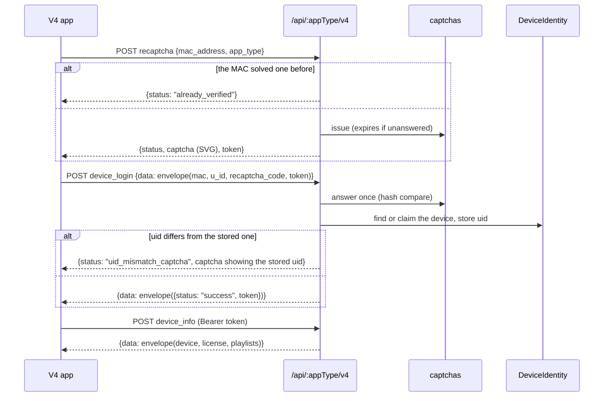
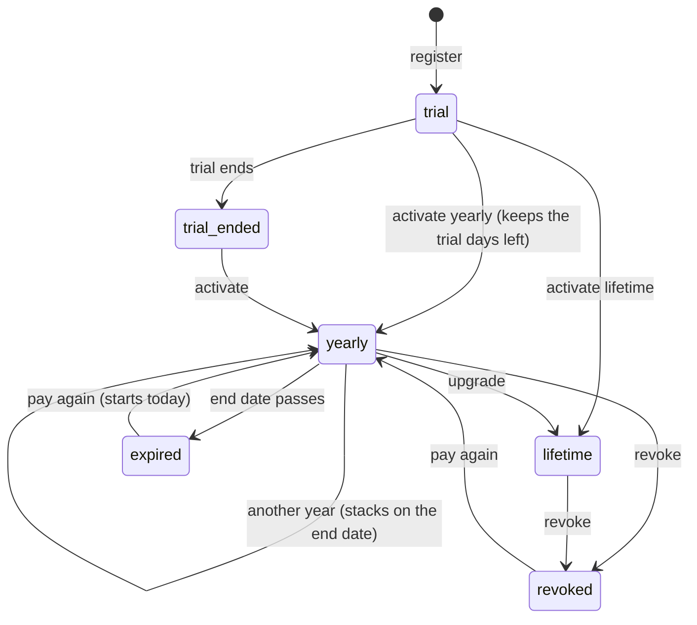
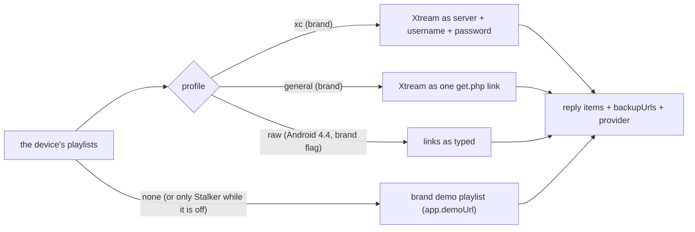

# Phase 3 · Core features

Branch `phase/3-core-features` · built on: `phase/2-database` · status: **done, in review**

**Tests:** [phase-3-core-features-tests.md](phase-3-core-features-tests.md): every test this phase adds, what it proves, how to run it, and the result on this branch.

The rules of devices, playlists and licenses on top of the Phase 2 collections, the first old-app routes (V4
login, `edit_playlist`), and the dev-only routes and playground to try them. Built by Omar on 26–27 Oct 2026;
reviewed by Ali.

## Contents

1. [Goal](#goal)
2. [Tasks and expected outputs](#tasks-and-expected-outputs)
3. [How the modules talk](#how-the-modules-talk)
4. [Flows](#flows)
5. [Schema changes](#schema-changes)
6. [HTTP routes](#http-routes)
7. [CLI and configuration](#cli-and-configuration)
8. [How to run and check it](#how-to-run-and-check-it)
9. [Open questions](#open-questions)
10. [Not in this phase](#not-in-this-phase)

## Goal

- A new device on any app gets a trial and comes back as the same device; fallback MACs never merge devices; V4
  devices register with a captcha.
- A device can be activated from any source, extended and revoked, and its license history listed.
- A device can add, edit, delete, protect and sync playlists, and gets them in its brand's reply format.
- **Merge point, Devices and licenses work:** register a device, activate it from two sources, extend it, revoke it.

## Tasks and expected outputs

| Feature | Id | Task | Expected output |
|---|---|---|---|
| Devices | DEV-1 | Register and find a device | unknown MAC → trial device (UUID, 6-digit key, trial ends end of day UTC after `trial.days`); an ended trial never gets a second one; each visit updates lastSeenAt, ip, versions |
| | DEV-2 | Devices without a usable MAC | a MAC made from `appDeviceId`; fallback MACs (`52:54:00:12:34:57/58/59`, Windows) never shared |
| | DEV-3 | One device for IBO Player, Pro and TV | same MAC on the three apps = one device; platform rule for a wrong app type |
| | DEV-4 | u_id and captcha registration (V4) | captcha issued, expires unanswered, answered once; a solved one is kept and lets the device skip the next; a different uid asks for the uid-recovery captcha |
| | DEV-5 | Device key and parent PIN | key change (old key stops working); PIN set, changed, off |
| | DEV-6 | V4 lock and store-review builds | a V4 device is refused by old routes; review builds from brand config `review.builds` answer lifetime |
| Playlists | PL-1 | Kinds and storage | m3u, xtream (parsed once), stalker, code; each fills only its part; no encryption of links |
| | PL-2 | Add, edit, delete, bulk sync | by device; sync by MAC adds, maps origin ids, removes `remove_ids`, touches only the caller's playlists; counters on trial devices |
| | PL-3 | PIN per playlist | `pinEnc` with the brand key; the dashboard needs the PIN, the app does not |
| | PL-4 | Reply shaping, demo, provider | xc / general / raw per brand and app; demo playlist from `app.demoUrl` |
| | PL-5 | Backup URLs | up to 8 hosts; replies carry `backupUrls` |
| | PL-6 | Add without login, by MAC only | per-IP rate limit |
| | PL-7 | Status sync | `account { status, expiresAt, checkedAt }` only; other fields ignored |
| | PL-8 | Bulk provider host rewrite | one brand, plain text host, count-only mode |
| Licensing | LIC-1 | License rules | state worked out from dates; stacking; credit cost 1 or 2 |
| | LIC-2 | Activate from any source | one use case; a trial device moves to `devices`; the same `sourceId` twice activates once; under a Redis lock per device |
| | LIC-3 | Revoke, expiry, history | revoke keeps the row; history with who activated |
| Old apps | — | V4 app routes | `/api/:appType/v4/recaptcha`, `device_login`, `device_info`, and `PUT /api/edit_playlist`, byte for byte |
| Tools | — | Dev routes, playground, e2e | `/dev/*` routes (404 in production), `/dev/playground`, `pnpm e2e:devices|playlists|licenses|v4` |
| Fixes | — | Index order, seed hang, knip | 0006/0007 index order (`1b0cb82`); the CLI exits once a command is done (`npm run seed` no longer hangs); unused exports removed (knip green) |

## How the modules talk

A module never imports another; what one needs from another is a port, bound once at the process root
(`src/module-settings.ts`).



## Flows

### Register a device (DEV-1, DEV-2, DEV-3)



### V4 login with a captcha (DEV-4)



### Activate, extend, revoke (LIC-1 to LIC-3)



The state is worked out from `trialEndsAt` and the current license; nothing above is stored as a status.
Activating a trial device moves it from `trialDevices` to `devices` (`DeviceIdentity.moveToPaid`).

### Playlist reply (PL-4, PL-5)



## Schema changes

| Migration | Change |
|---|---|
| `0006-playlist-account` | playlists get `account { status, expiresAt, checkedAt }` (status sync, PL-7) |
| `0007-playlist-name-unique` | one name per device, case-insensitive (`name_once_per_device`); older duplicates renamed "Name (2)", "Name (3)" |

Brand config adds `review.builds` (platform + version of store-review builds, empty by default). Brand secret
`playlists.pinKey` (32 random bytes) encrypts playlist PINs.

## HTTP routes

Old-app routes (same paths and formats as the old backends; `@LegacyDevice()`):

| Method | Path | Body / answer |
|---|---|---|
| POST | `/api/:appType/v4/recaptcha` | `{mac_address, app_type}` → `already_verified`, or `{captcha, token}` |
| POST | `/api/:appType/v4/device_login` | `{data: envelope}` → `{data: envelope({status, token})}` |
| POST | `/api/:appType/v4/device_info` | Bearer token, `{data: envelope}` → device, license, playlists |
| PUT | `/api/edit_playlist` | `{mac_address, id, status, expiration_date…}` → only the account status is kept |
| POST | `/api/:appType/v4/manage/add_playlist`, `…/manage/update_playlist` | Bearer, `{data: envelope}`; with `playlistId` it updates, without it adds (both routes, as before) → plain JSON `{status, msg, playlist}` |
| POST | `/api/:appType/v4/manage/delete_playlist` | Bearer, `{data: envelope({mac_address, playlistId})}` → plain JSON |
| POST | `/api/:appType/v4/device/add` | Bearer → `{data: envelope}` StarArcs' guest login reply, relayed |
| POST | `/api/changeParentPin` | `data=envelope({mac_address, pin_code})`, form or JSON, no token → `{data: envelope({status, msg})}` |

The last four (added 28 Oct) complete what the IBO, Bob and CR TV apps call; all three start through V4. Notes:

- **manage/\***: types `general` (a link), `xc` (a server with username and password, or a `get.php` link) and
  `stalker`. The reply's `playlist` has the `device_info` `urls` shape plus `_id` and `device_id`. The old refusal
  messages are kept. **Changed on purpose:** an update may leave out the PIN of a protected playlist and keeps it
  protected, since `device_info` never sends PINs back. The same playlist twice on one device is refused (PL-2); the
  apps currently treat that refusal as "offline" (an app fix, noted in the apps' testing notes).
- **The bearer check** of manage and device/add is the old `verifyAnyDeviceToken`: no token 401; a bad token, a device
  of another app type than the route, or another MAC or `app_type` in the body 403, encrypted when the body could be
  read.
- **device/add** registers the token's device on StarArcs (`POST {STARARCS_URL}/api/v3/tv/auth`, header
  `X-Secret-Token`) under the brand's `stararcs.appName`; without the key or the name the app gets `{status: "error"}`.
- **changeParentPin**: 4 digits turn parental control on, `""` or `null` off.

### Old routes before V4 (added 28 Oct)

App builds older than V4 call these. Same paths, request formats and reply fields as the old backends, from the
contracts read out of their code (ibo, bob and cr). The same path answered with **different fields on each old
backend**, so each brand says which one its apps expect: the brand setting **`legacy.dialect`** (`ibo`, `bob` or `cr`;
default `ibo`). The app keys are **brand secrets**, because each old backend had its own.

| Method | Path | Who calls it | Body → answer |
|---|---|---|---|
| GET | `/api/status_check` | every app | `{status, message}` |
| GET | `/api/get_app_setting/:mac` | bob | `{status: "success"}` |
| POST | `/api/playlist_info` | TV apps | `{data: envelope({mac_address, app_type, version, app_device_id})}` → device info |
| POST | `/api/playlist_information` | oldest Android | `{data: AES}` → `{data: AES}` |
| GET | `/api/playlist_information/:mac/:appType?` | ibo's oldest TV builds | plain device info |
| POST | `/api/playlist_list` | ibo | envelope; the playlists only, never makes a device |
| POST | `/api/MBBPj5UwlCmTstXGb/android/playlist_information`, `/api/Mxcvfghytrhjsjj/tv/playlist_information` | signed Android, bob TV | `{data: AES, signature}` → `{data: AES}` |
| POST | `/api/MBBPj5UwlCmTstXGb/tv/v3/playlist_information` | signed TV v3 | ibo: TV keys and a `u_id` made from the MAC; bob: Android keys, no `u_id` |
| POST | `/api/MBBPj5UwlCmTstXGb/android/v3/playlist_information` | ibo | never answered with data (broken key handling); kept so |
| POST | `/api/check_active_status` | Android | `{data: AES({mac_address})}` → `{data: AES({status, expire_date})}` |
| POST | `/api/v4/recaptcha` | TV apps' first start | ibo `{captcha, token}` (or `already_verified`); cr `{captcha}` |
| POST | `/api/tv/v4/playlist_info` | cr's CRPlayer | static app key (`Authorization` or `token`) and the typed captcha code → device info; counts as V4 |
| POST | `/api/device_info` | cr smart TV builds | envelope, by `app_device_id`; a made-up MAC when new |
| POST | `/api/update_playlist` | TV apps' offline sync | envelope `{mac_address, playlists, remove_ids}` → one line per saved playlist |
| POST | `/api/add_playlist`, `/api/remove_playlist` | cr TV apps | envelope (a plain form with `legacy.plainBodyAddRemove`) |
| POST | `/api/MBBPj5UwlCmTstXGb/manage/{add,update,delete}_playlist` | signed Android | `{data: AES, signature}` → plain `{status, msg}` or `{status, result}` |
| POST | `/api/device_login`, `/api/register_device` | Roku | `{mac, model?}` → token and device (and playlists) |
| POST | `/api/validate_status`, `/api/activate_free_trial`; GET and POST `/api/playlist` | Roku | `Authorization: <token>` |
| POST | `/api/{ios,android}/{v2,v3}/device_login`, `…/reset_uid`, `…/validate_status`; GET and POST `…/playlist` | old iOS and Android | `{mac, uid}`; the device is bound to the app's uid |
| POST | `/api/android/v3/generate_captcha` | cr Android | `{svg, token}`; a new Android device on cr registers only with it |

Rules (the modules' own): a call that names a device records the visit, and a new device gets a trial (DEV-1); a
device that moved to V4 is refused by these older routes (DEV-6), as the old backends did; the replies come from the
same license and playlist rules as V4 (`legacy-info.ts` picks each backend's fields).

**Kept from the old code on purpose:** the paths, the fields and their types (a new device's key as a number, then as
text; `is_trial` 0/1/2/3; `trial_days` as text on bob), the refusal messages, the Roku `{error, message, status}`
reply with HTTP 200, and `reset_uid` with the MAC as the only proof (the old apps have nothing else to send; see
Open questions below).

**Not copied (bugs or holes in the old code):**

- crashes that left a request unanswered and killed the server process: each such input now gets the nearest error;
- `update_playlist` moved or deleted **any** device's playlist by id, and answered with the values from before the
  change: it now only touches the calling device's own playlists and answers with the saved values; CRPlayer's `name`
  is read (the old cr route read `playlist_name` and saved nameless playlists);
- cr's smart TV `device_info` without an id answered with a stranger's device: the id is now required;
- the signed `manage/*` routes looked the MAC up as a pattern (`.*` matched any device): a MAC is now parsed;
- tokens on the Roku and mobile routes are checked against the device id and MAC (the old ones used the MAC alone);
- dates are full `YYYY-MM-DD`; "expired" means today, not the time the old server process started; the demo entry is
  built fresh each time (the old one was changed in memory by earlier calls); cr's Android `GET …/playlist` answers
  (it always failed before); no honeypot replies and no test-device wipe.

**Later phases:** the IP guards and Cloudflare blocks (Protection); themes, languages, notifications and Android
update offers are empty (Content); bob's pull of IBO activations; recovery (`apply_recovery`, `tv/v3/recover-*`) in
Phase 4.

Dev-only routes (`@Public()`, 404 in production), used by the playground and the e2e scripts:

| Area | Routes |
|---|---|
| Devices | `POST /dev/devices/register`, `GET /dev/devices/:mac`, `POST /dev/devices/captcha`, `POST /dev/devices/v4/login`, `POST /dev/devices/v4/uid-captcha`, `POST /dev/devices/captcha-code`, `POST /dev/devices/key/verify`, `POST /dev/devices/:id/key`, `POST /dev/devices/:id/parent-pin` |
| Playlists | `GET /dev/playlists/:mac`, `GET …/:mac/reply`, `GET …/:mac/dashboard`, `POST …/:mac/add`, `POST …/:mac/:id/edit|delete|pin|unlock|backup|status`, `POST …/:mac/sync`, `POST …/:mac/by-mac/add|delete`, `POST /dev/playlists/move-host` |
| Licenses | `GET /dev/licenses/:mac`, `GET …/:mac/history`, `POST …/:mac/activate`, `POST …/:mac/revoke` |
| Playground | `GET /dev/playground`, `GET /dev/brands` |

## CLI and configuration

```sh
pnpm cli playlists:pin-keys [slug...]   # creates each brand's playlist PIN key; never replaces one
npm run seed                            # now also runs playlists:pin-keys
```

New variables (optional; the old-app routes need them): `LEGACY_DEVICE_TOKEN_KEY` (the V4 token, also the Roku and
mobile tokens).

The routes before V4 also need, per brand:

```sh
pnpm cli tenant:set <slug> legacy.dialect cr                  # ibo (default), bob or cr: whose replies its apps expect
pnpm cli tenant:set-secret <slug> legacy.androidAesSecret     # old ANDROID_AES_SECRET
pnpm cli tenant:set-secret <slug> legacy.androidAesNewSecret  # old ANDROID_AES_NEW_SECRET (signed v2)
pnpm cli tenant:set-secret <slug> legacy.androidSigningSecret # old ANDROID_SIGNING_SECRET
pnpm cli tenant:set-secret <slug> legacy.tvAesSecret          # ibo: old TV_AES_NEW_SECRET (signed TV v3)
pnpm cli tenant:set-secret <slug> legacy.tvSigningSecret      # ibo: old TV_SIGNING_SECRET
pnpm cli tenant:set-secret <slug> legacy.tvKey                # cr: old TV_KEY_V4 (CRPlayer)
```

The values are the old backends' (in each backend's `.env`; never committed). A route whose key is not set refuses
every call.

StarArcs (`device/add`): `STARARCS_GUEST_TOKEN` (the partner key, one for every brand, never committed) and
`STARARCS_URL` (default `https://backend.stararcs.com`), plus each brand's app name:
`pnpm cli tenant:config:set <slug> stararcs.appName <name>` (`iboplayer`, `bobplayer`; the cr brands' names are in the
old cr `APP_<TENANT>_APP_NAME` variables).

## How to run and check it

```sh
npm run seed
pnpm dev:api                           # http://ibo.localhost:3000/dev/playground
pnpm e2e:devices && pnpm e2e:playlists && pnpm e2e:licenses && pnpm e2e:v4 && pnpm e2e:legacy
pnpm format:check && pnpm lint && pnpm typecheck && pnpm knip && pnpm test && pnpm test:int && pnpm build
```

Checked on this branch (27 Oct 2026): format, lint, typecheck, knip and build green; **unit 455/455**;
**integration 43/43**; end to end devices 46/46, playlists 24/24, licenses 19/19, V4 21/21.

## Open questions

`docs/phase-1/DISCUSSIONS.md` in this branch: how modules read brand config, the Windows fallback MAC, DEV-3 merge
at runtime or in the data move, V4 login for old devices, the IBO store-review flag, and yearly stacking with what
a revoke takes away (#6, which changes LIC-1 and LIC-3).

**Routes before V4, to settle (Omar to Ali, 28 Oct 2026):**

1. **Each brand needs `legacy.dialect`.** The default is `ibo`. Before launch: `bob` on the BOB brand, `cr` on every
   brand that came from cr-unified (22 of them), and the app keys (brand secrets `legacy.*` above), copied from each
   old backend's `.env`.
2. **`reset_uid` (old iOS and Android apps).** A reinstalled app sends the device's MAC and its new install id, and
   takes the device over. The MAC is the only proof; the old apps have nothing else to send. Kept as it was. Option:
   refuse it for paid devices and send the owner to the website.
3. **ibo's signed Android v3 route** never answered with data (its key handling was broken), so no app uses its
   answer. Kept as it was: valid calls get `Request Not Processed`. Option: build what it was meant to do.
4. **bob's `playlist_information`** answered with an envelope no app can read (no key). We answer as ibo did: AES
   with the old Android key. Option: treat it as dead.
5. **The IP guards** of ibo and bob (which also deleted devices when they blocked an IP) are not rebuilt here; they
   belong to Protection and jobs.

## Not in this phase

MAC switch, recovery (with the old `apply_recovery` and `tv/v3/recover-*` routes), provider domain moves and the
cleanup of old trial devices come in Phase 4 · Moves and cleanup ([ROADMAP.md](../ROADMAP.md)).
