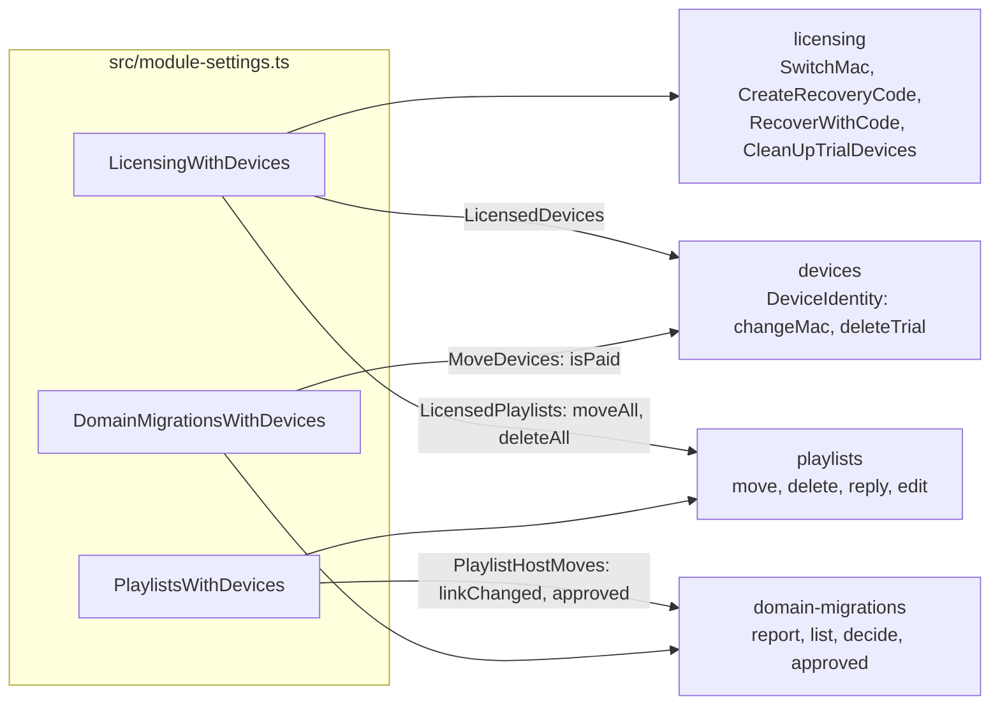
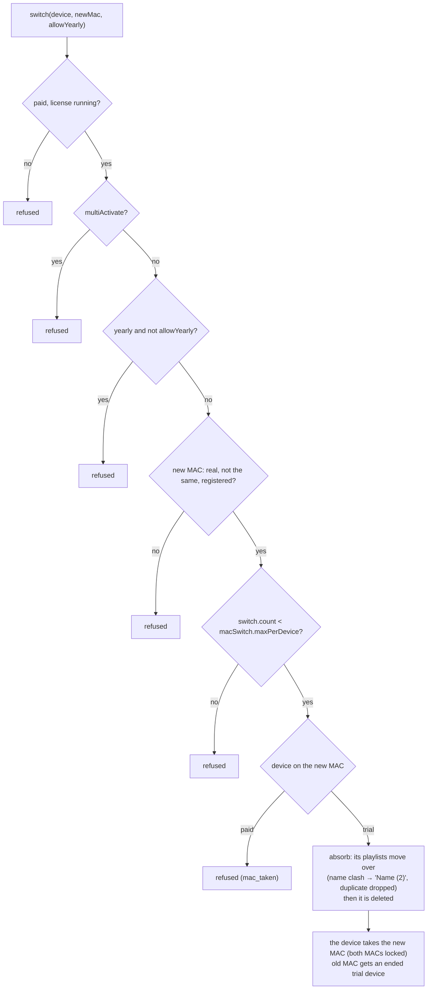
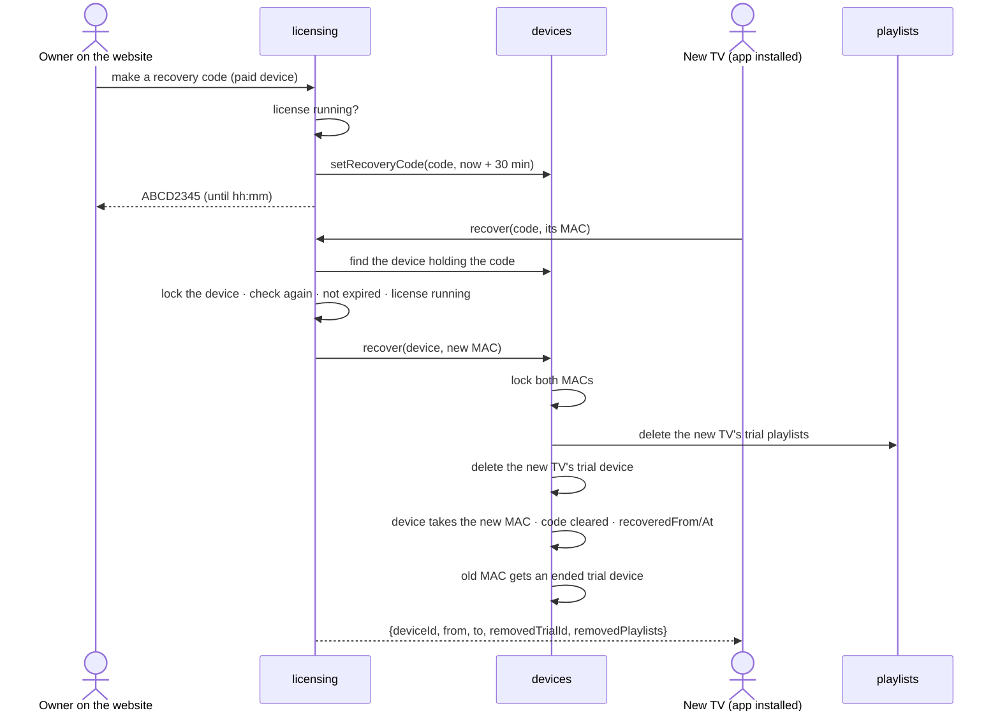
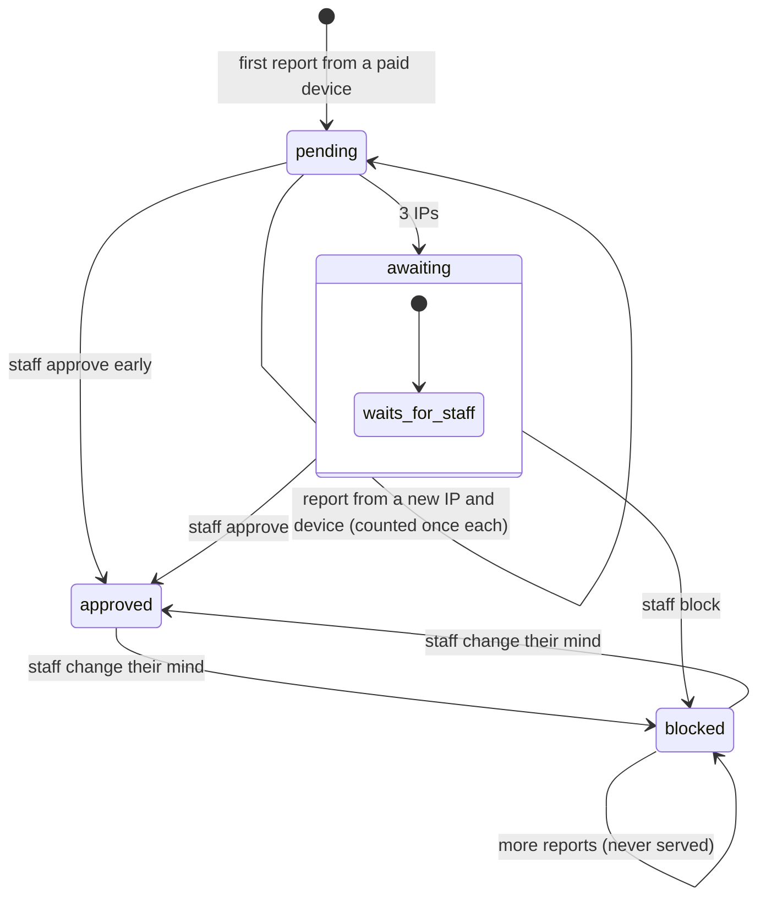
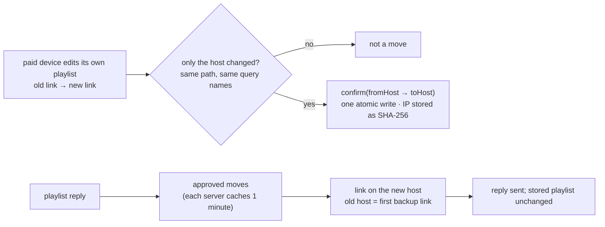
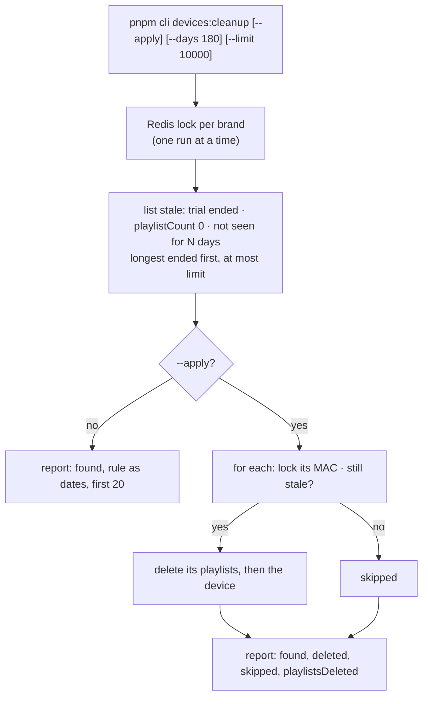
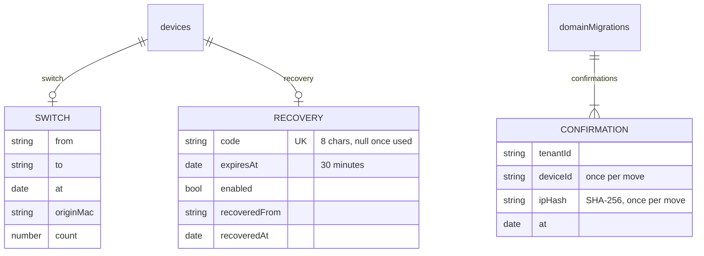

# Phase 4 · Moves and cleanup

Branch `phase/4-moves-and-cleanup` · built on: `phase/3-core-features` · status: **done, in review**

**Tests:** [phase-4-moves-and-cleanup-tests.md](phase-4-moves-and-cleanup-tests.md): every test this phase adds, what it proves, how to run it, and the result on this branch.

Everything that moves a device, a license or a provider, and the cleanup of old trial devices: the parts of the
device core that need licensing first. With this phase the device core is complete. Built by Ali on 27 Oct 2026.

## Contents

1. [Goal](#goal)
2. [Tasks and expected outputs](#tasks-and-expected-outputs)
3. [How the modules talk](#how-the-modules-talk)
4. [MAC switch](#mac-switch-dev-7)
5. [Recovery](#recovery-rec-1-to-rec-3)
6. [Provider domain moves](#provider-domain-moves-dom-1-dom-2)
7. [Cleanup of old trial devices](#cleanup-of-old-trial-devices-lic-4)
8. [Schema changes](#schema-changes)
9. [HTTP routes and CLI](#http-routes-and-cli)
10. [How to run and check it](#how-to-run-and-check-it)
11. [Choices to confirm](#choices-to-confirm)

## Goal

- A paid device moves to a new MAC with its license and playlists (MAC switch, by the owner; recovery, with a
  code from the website). Nothing is left behind and each MAC keeps exactly one device.
- A provider move reported by paid devices on different IPs is served only after staff approve it.
- Old trial devices nobody uses are removed safely, with their playlists.
- **Merge point, Device core works:** add and sync playlists, switch the MAC of a paid device, recover it on a new
  TV, approve a provider move, dry-run the cleanup. Then **CORE**: the whole flow on two brands.

## Tasks and expected outputs

| Feature | Id | Task | Expected output | Done when |
|---|---|---|---|---|
| MAC switch | DEV-7 | Move a paid license to a new MAC | the device keeps its id, license and playlists; `switch` records from, to, when, count, first MAC | refused for multiActivate, a yearly without allow, a non-running license, a paid device on the new MAC, an unregistered MAC; limit from `macSwitch.maxPerDevice` |
| Recovery | REC-1 | Recovery code | 8 characters, 30 minutes, a new one replaces the old; paid devices with a running license only | a trial or revoked device is refused |
| | REC-2 | Apply the code on a new TV | the paid device takes the new TV's MAC with its id, license, playlists; `recovery.recoveredFrom/At` | a code works once; wrong, expired or used codes refused; two TVs at once → one wins |
| | REC-3 | Nothing left behind | the new TV's trial device removed with its playlists; the old MAC keeps an ended trial | each MAC has exactly one device after a recovery |
| Provider moves | DOM-1 | Learn provider host moves | a paid device editing its own playlist so only the host changes reports `fromHost → toHost`; one per IP and per device; IP hashed | after 3 IPs the move waits for approval and is not served |
| | DOM-2 | Approve before it is served | approve / block with who and when (CLI, dev route) | replies use the new host only for approved moves; stored playlists unchanged; blocked never served |
| Cleanup | LIC-4 | Expiry and cleanup | `devices:cleanup`: ended trials, `playlistCount` 0, not seen for N days (180); dry run by default; report | a dry run gives a report we agree with; a real run removes devices with their playlists |
| Tools | — | Playground and e2e | tabs for recovery and provider moves; `pnpm e2e:moves` | 32/32 |

## How the modules talk



## MAC switch (DEV-7)



## Recovery (REC-1 to REC-3)



Codes use `ABCDEFGHJKLMNPQRTUVWXYZ23456789` (no I, O, S, 0, 1) and are read in any case. One code belongs to one
device (`recovery_code_unique`). A recovery does not count as a MAC switch.

## Provider domain moves (DOM-1, DOM-2)



"Awaiting" is a pending move with 3 or more IPs; it is not stored as its own status.

How a report is made and a move is served:



## Cleanup of old trial devices (LIC-4)



Paid devices are never deleted. A removed device that comes back registers as new, with a new trial.

## Schema changes

| Change | Where |
|---|---|
| `0008-device-recovery-code` | `devices`: index `recovery_code_unique` on `recovery.code` (partial: only when set) |
| `devices.switch.count`, `switch.originMac` | how many switches, and the first MAC; a record saved before the count reads as 1 |
| `devices.recovery.code` | 8 characters, cleared once used |
| brand config `macSwitch.maxPerDevice` | switches per device, 1 by default; 0 turns switching off |



## HTTP routes and CLI

Dev-only routes (404 in production):

| Method | Path | What |
|---|---|---|
| POST | `/dev/licenses/:mac/switch` | `{ newMac, allowYearly }` (DEV-7) |
| POST | `/dev/licenses/:mac/recovery-code` | → `{ code, expiresAt }` (REC-1) |
| POST | `/dev/licenses/recover` | `{ code, newMac }` (REC-2, REC-3) |
| GET | `/dev/licenses/cleanup?days=N` | cleanup report, dry run only (LIC-4) |
| GET | `/dev/domain-moves?filter=awaiting\|pending\|approved\|blocked` | moves with counts (DOM-2) |
| POST | `/dev/domain-moves/:id/approve` · `/block` | `{ by }` |
| POST | `/dev/playlists/:mac/:id/edit` | now takes `ip`, to stand in for different devices (DOM-1) |

```sh
pnpm cli devices:cleanup [--days N] [--limit N] [slug...]       # dry run
pnpm cli devices:cleanup --apply [--days N] [slug...]
pnpm cli domain-moves:list [awaiting|pending|approved|blocked]
pnpm cli domain-moves:approve <id> <who>
pnpm cli domain-moves:block <id> <who>
```

Old-app recovery routes (same paths and replies as the old backends; added 28 Oct with the Phase 3 routes before V4):

| Method | Path | Body → answer |
|---|---|---|
| POST | `/api/:appType/v4/apply_recovery` | V4 token of the new TV; plain `{recovery_code, new_mac_address, app_type}` → `{status, message, mac_address, is_trial, expire_date}` |
| POST | `/api/tv/v3/recover-summary` | cr: `{recovery_code, mac_address}` → what would move (`summary.old_device`, `new_device`, `after_recovery`), nothing changed |
| POST | `/api/tv/v3/recover-my-device` | cr: the same, and the device moves → `{status: true, msg, data}` |

All three call REC-2 and REC-3 (`RecoverWithCodeUseCase`); cr's refusals keep their HTTP codes (404 wrong code or
unregistered TV, 410 expired code, 400 the rest). **Changed on purpose:** the old `apply_recovery` took any logged-in
device's token, so any app could use any code: the token must now be the new TV's own (`new_mac_address` is its MAC).
A paid device already on the new MAC is refused (the old code gave it the old MAC and marked it for deletion). The
website's code route comes with the website phase.

## How to run and check it

```sh
npm run seed
pnpm dev:api                          # playground: License, switch, recovery · Provider moves
pnpm e2e:moves                        # and the five Phase 3 scripts (e2e:legacy also checks recovery)
pnpm format:check && pnpm lint && pnpm typecheck && pnpm knip && pnpm test && pnpm test:int && pnpm build
```

Checked on this branch (27 Oct 2026): format, lint, typecheck, knip and build green; **unit 513/513**;
**integration 51/51** (adds `device-moves`); end to end moves 32/32 and the Phase 3 scripts all green.

## Choices to confirm

Ten choices made while building, in [DISCUSSIONS.md #7](../DISCUSSIONS.md#7-phase-4-choices-to-confirm): the old MAC
after a recovery, refusing a paid device on the new MAC, the swap with the old host as backup, learning only from
own edits, and the cleanup rule (180 days) among them. Rules by task: [modules/](../modules/).
