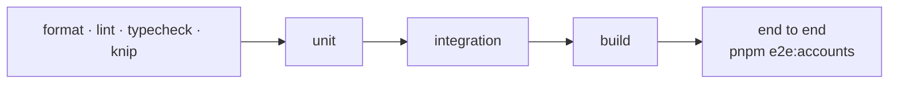

# Phase 5 · Accounts and staff: tests

The tests this phase adds; the phase page is
[phase-5-accounts-and-staff.md](phase-5-accounts-and-staff.md). The tests of Phases 1 to 4 keep running.

## The checks

## Unit tests to write

| Task | Must prove |
|---|---|
| ACC-1 | document shapes of `customers`, `staffUsers`, `roles`, `permissions` round-trip; emails lowercase |
| ACC-2 | a password hashes and verifies; a wrong one fails; an old bcrypt hash verifies unchanged |
| CUS-1 | sign-up: email unique in the brand; the same email on another brand is a separate account; a verification link works once and expires |
| CUS-2 | login: a wrong password and an unknown email give the same answer; logout ends the session; reset link works once |
| CUS-3 | link a device by MAC + device key; a device belongs to one customer; another brand's device is not found; unlink |
| CUS-4 | a new email clears `emailVerifiedAt` until verified |
| PRM-1 | startup sync: new keys inserted, edited labels kept, missing keys made inactive and removed from every role |
| PRM-2 | the `super_admin` role cannot be edited or deleted; a role with an unknown or inactive key is refused |
| STF-1 | staff login with bcrypt; disabled staff refused; `lastLoginAt` set |
| STF-2 | create, edit, disable staff; a disabled member's session stops working |
| STF-3 | access: missing permission → 403; brand outside `tenantAccess` → 403 even with the permission; `*` allows every brand; `super_admin` allows everything |

## Integration tests to write

| Must prove |
|---|
| migrations create the four collections with `email_unique` (per brand for customers, central for staff), `name_unique` on roles |
| two brands: a customer of A cannot log in on B with the same email unless signed up there |
| the permission sync runs against real MongoDB and is safe to run on several servers at once |
| a session cut off (disabled staff) is refused on every server (Redis sessions, if chosen) |

## End-to-end scenarios to write (`pnpm e2e:accounts`)

| Id | Scenario | Expected |
|---|---|---|
| E2E-A1 | Sign up, verify, log in on brand A; the same email on brand B | two separate accounts |
| E2E-A2 | Link a TV with MAC + device key; list devices | the TV is listed; another customer cannot link it |
| E2E-A3 | Staff with a role limited to brand A activates a device on A, then on B | A allowed, B refused |
| E2E-A4 | Super admin removes a permission from a role | the next request with it is refused |
| E2E-A5 | Disable a staff member while logged in | the next request is refused |

## Where the tests are

| Task | Tests |
|---|---|
| ACC-1 | `customers/infrastructure/customer.document.spec.ts`, `staff/infrastructure/staff.documents.spec.ts`; `test/integration/accounts.int-spec.ts` (migrations, two brands, seeded roles) |
| ACC-2 | `shared/crypto/bcrypt-password-hasher.spec.ts` (`$2a$` / `$2b$` cost-10 hashes verify) |
| CUS-1, CUS-2, CUS-4 | `customers/application/use-cases/customer-account.use-cases.spec.ts` |
| CUS-3 | `devices/application/use-cases/customer-devices.use-cases.spec.ts` |
| PRM-1 | `staff.use-cases.spec.ts` (sync), `interfaces/http/accounts/permission-keys.spec.ts`, `test/unit/route-access.spec.ts` (every staff route is synced), concurrent sync in `accounts.int-spec.ts` |
| PRM-2, STF-1 … STF-3, 2FA | `staff/application/use-cases/staff.use-cases.spec.ts`; the guard in `shared/auth/access.guard.spec.ts`; TOTP against the RFC 6238 vectors in `shared/kernel/totp.spec.ts` |
| Sessions | `accounts.int-spec.ts`: two servers, revoke-all ends both; tokens stored hashed |
| Playground | `/dev/playground` tabs **Customer** (CUS-1 … 4) and **Staff and roles** (STF, PRM, 2FA); dev-only `POST /dev/staff/super-admin` makes the first super admin there |
| E2E-A1 … A5 | `tools/dev/e2e-accounts.mjs` (52 checks, also password reset, profile, logout, two-factor login) |

`pnpm e2e:accounts` refuses to run without `MONGO_URI` on the command line, so it never writes to the database in
`.env`. It makes its super admin with `pnpm cli staff:create`. Login tries are rate limited (10 per 15 minutes per IP),
so a second run within 15 minutes needs a fresh Redis.

## Result on this branch

| Date | Static | Unit | Integration | Build | End to end | Playground |
|---|---|---|---|---|---|---|
| 28 Oct 2026 | format, lint, typecheck, knip green | **583/583** | **59/59** | OK | accounts 52/52, and no change to the earlier ones: moves 32/32, devices 46/46, playlists 24/24, licenses 19/19, v4 21/21 | Customer and Staff tabs driven in a headless browser (26 steps: sign-up to reset, linking a TV, roles, a Billing member refused on another brand), no page errors |
| 28 Oct 2026 (rebuilt on Ali's Phase 4, with the Phase 3 app routes) | format, lint, typecheck, knip green | **592/592** | **59/59** | OK | accounts 52/52, v4 49/49, moves 32/32, devices 46/46, playlists 24/24, licenses 19/19 | Customer and Staff tabs on the new playground: 26 steps, no page errors |
