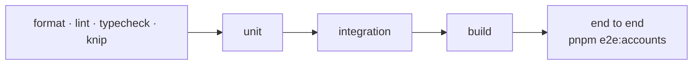

# Phase 5 · Accounts and staff: tests (planned)

The tests this phase must add before it is done. Nothing here is written yet; the phase page is
[phase-5-accounts-and-staff.md](phase-5-accounts-and-staff.md). The tests of Phases 1 to 4 keep running.

## The checks

## Unit tests to write

| Task | Must prove |
|---|---|
| ACC-1 | document shapes of `customers`, `staffUsers`, `roles`, `permissions` round-trip; emails lowercase |
| ACC-2 | a password hashes and verifies; a wrong one fails; an old bcrypt hash verifies unchanged |
| CUS-1 | sign-up: email unique in the brand; the same email on another brand is a separate account; a verification link works once and expires |
| CUS-2 | login: a wrong password and an unknown email give the same answer; logout ends the session; reset link works once |
| CUS-3 | link a device by MAC + device key; a device belongs to one customer; another brand's device is not found; unlink |
| CUS-4 | a new email clears `emailVerifiedAt` until verified |
| PRM-1 | startup sync: new keys inserted, edited labels kept, missing keys made inactive and removed from every role |
| PRM-2 | the `super_admin` role cannot be edited or deleted; a role with an unknown or inactive key is refused |
| STF-1 | staff login with bcrypt; disabled staff refused; `lastLoginAt` set |
| STF-2 | create, edit, disable staff; a disabled member's session stops working |
| STF-3 | access: missing permission → 403; brand outside `tenantAccess` → 403 even with the permission; `*` allows every brand; `super_admin` allows everything |

## Integration tests to write

| Must prove |
|---|
| migrations create the four collections with `email_unique` (per brand for customers, central for staff), `name_unique` on roles |
| two brands: a customer of A cannot log in on B with the same email unless signed up there |
| the permission sync runs against real MongoDB and is safe to run on several servers at once |
| a session cut off (disabled staff) is refused on every server (Redis sessions, if chosen) |

## End-to-end scenarios to write (`pnpm e2e:accounts`)

| Id | Scenario | Expected |
|---|---|---|
| E2E-A1 | Sign up, verify, log in on brand A; the same email on brand B | two separate accounts |
| E2E-A2 | Link a TV with MAC + device key; list devices | the TV is listed; another customer cannot link it |
| E2E-A3 | Staff with a role limited to brand A activates a device on A, then on B | A allowed, B refused |
| E2E-A4 | Super admin removes a permission from a role | the next request with it is refused |
| E2E-A5 | Disable a staff member while logged in | the next request is refused |

## Result

Not started.
